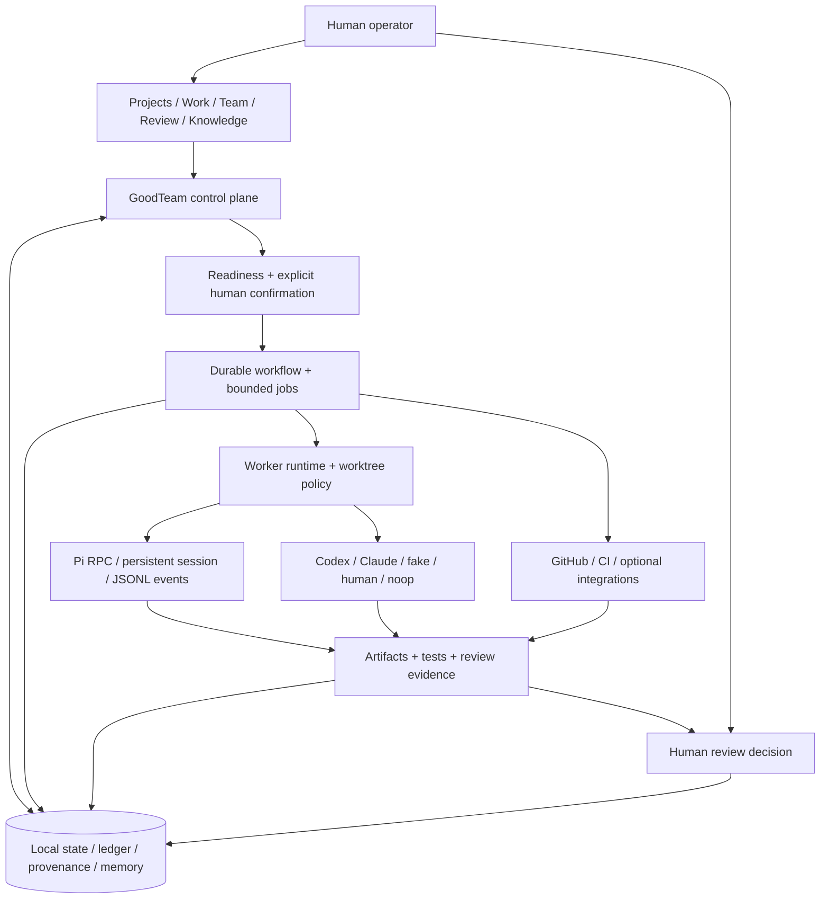

<div align="center">

# GoodTeam

### A local-first control plane for AI software delivery

Turn a project conversation into bounded engineering work,<br>
with persistent state, reviewable evidence, and explicit human decisions.

<p>
  <a href="docs/architecture.md"></a>
  <a href="pyproject.toml"></a>
  <a href="frontend/package.json"></a>
  <a href="docs/worker-backends.md#pi-persistent-sessions"></a>
  <a href="docs/m0-product-acceptance.md"></a>
</p>

[Overview](#overview) · [Capabilities](#capabilities) · [Architecture](#architecture) · [Quick start](#quick-start) · [Documentation](#documentation) · [Contributing](#contributing)

</div>

---

## Overview

GoodTeam coordinates AI-assisted engineering around an owned delivery protocol: understand the repository, agree on a bounded task, dispatch Workers, collect verification and review evidence, and preserve the human decision trail.

Project iteration uses one execution path: Manager selection enters the existing
Task Assistant queue and isolated Worker pool. Owners can approve a fixed task
list, or additionally opt into bounded follow-up discovery from verified landed
results. Checks, independent review, failure recovery and delivery retain their
own evidence; a Worker completion does not mark the project task delivered.

**GoodTeam owns the control plane; coding agents and external tools are adapters.** A Worker can produce a patch, a test result, or a recommendation. It cannot turn its own output into approval.

**Open repo → Describe task → Confirm plan → Follow execution → Review result**

The desktop Web experience stays centered on one project conversation:

| Surface | What you do |
| --- | --- |
| **Projects** | Import or open an explicitly selected local repository. |
| **Work · Task Assistant / 任务助手** | Understand the project, clarify a task, confirm a proposal, and follow progress or recovery in the same conversation. |
| **Team** | Configure project Roles, TeamRole membership, and Worker identities and runtimes. |
| **Review** | Inspect evidence and make explicit approval or change decisions. |
| **Knowledge** | Explore repository understanding, artifacts, provenance, and memory. |

> **Current stage:** real-model delivery acceptance is pending under [M0 / #411](docs/m0-product-acceptance.md). Implemented features and deterministic CI coverage are not a claim of complete product acceptance.

## Capabilities

| Capability | What GoodTeam provides |
| --- | --- |
| **Durable conversation** | Project understanding, task clarification, progress, and recovery stay in one Task Assistant conversation, preserving the original request across workflow runs. |
| **Configurable engineering team** | **Role → TeamRole → Worker** separates capabilities, project membership, and runtime identity. Codex, Claude/Anthropic, Pi, `fake`, `human`, and `noop` adapters serve different execution needs. |
| **Persistent Pi runtime** | Pi RPC sessions support explicit resume, steering, follow-up, abort, and incremental event replay. Session metadata and JSONL protocol/event records remain tied to the originating job. |
| **Traceable delivery** | Tasks, attempts, Workers, worktrees, PRs, commit SHAs, CI, artifacts, and reviewer evidence connect through execution identity and a durable ledger. |
| **Bounded project iteration** | Continue across approved batches, with optional outcome-based discovery inside an explicit objective, path scope and finite task/planning budgets. Existing batch execution supports up to 10 concurrent Workers. |
| **Candidate quality and recovery** | Explicit batch checks and independent review can request one authorized correction. Retry only proven failed tasks while retaining successful siblings, or explicitly abandon stopped, undelivered work. |
| **Explicit human decisions** | Workflow starts, task changes, and approvals are bound to server-owned state. Model interpretation and Worker output provide advice and evidence, not authority. |
| **Local-first records** | Conversations, workflow state, checkpoints, task ledgers, artifacts, and memory persist in local workspace/project storage, with optional external integrations. |

Explore [Worker backends and Pi controls](docs/worker-backends.md), [execution identity](docs/execution-identity.md), and the [review and approval guide](docs/review-and-approval-guide.md).

For the project loop, read [continuation](docs/project-continuation.md),
[candidate quality](docs/project-batch-quality.md), [failed-batch recovery](docs/project-batch-recovery.md)
and [outcome-based task discovery](docs/project-outcome-discovery.md). Discovery
currently proposes at most one new follow-up per accepted delivery. Quality is
configured per successful batch, and landing/release remain explicit owner
actions. These implemented boundaries do not claim complete real-model project
autonomy acceptance; that evidence remains tracked in #419. Automatic GitHub CI
remains paused by the owner.

Local-first describes ownership of state, not offline model execution. External providers still require configured access; Pi itself is not a sandbox. GoodTeam retains runtime/worktree policy and approval responsibility.

## Architecture



| Layer | Responsibility | Source |
| --- | --- | --- |
| Product UI | Project conversation and focused Team, Review, and Knowledge workbenches | [`frontend/`](frontend/) |
| Control plane | HTTP/API boundaries, Task Assistant, readiness, and Team decisions | [`src/goodteam_os/`](src/goodteam_os/) |
| Workflow & runtime | Gates, bounded dispatch, Worker lifecycle, and persistent execution | [`graph.py`](src/goodteam_os/graph.py), [`workers.py`](src/goodteam_os/workers.py) |
| Durable records | Workflow state, task ledger, artifacts, provenance, and memory | [Architecture reference](docs/architecture.md) |

See the [architecture guide](docs/architecture.md) for detailed component boundaries and sequence diagrams.

## Quick start

### Prerequisites

- **Python 3.11+** with `venv` and `pip`
- **Node.js 24.22.1** (the development/CI default in `.nvmrc`), or **22.23.4+ within the 22.x line**, plus npm, for the current frontend toolchain. These minimums include the [October 2026 security fixes](https://nodejs.org/en/blog/vulnerability/october-2026-security-releases); Node.js 20 is end-of-life. Run `nvm install && nvm use` from the repository root before installing frontend dependencies
- **Git** and a local repository you intend to work on
- For real Workers: a supported agent CLI and explicitly verified provider/model configuration; installation alone does not prove readiness

The commands below use a POSIX-style shell. They install and start the local application; they do not dispatch a coding task.

### 1. Install

```bash
git clone https://github.com/LukeJiaoR/GoodTeam.git
cd GoodTeam

python3 -m venv .venv
source .venv/bin/activate
pip install -e ".[dev]"
npm --prefix frontend install
npm --prefix frontend run build
```

### 2. Start the local service

```bash
goodteam restart
goodteam status
```

Open **[localhost:21001/projects](http://localhost:21001/projects)**.

The service defaults to `127.0.0.1:21001` and the current directory as its workspace (`--workspace` overrides it). If an installation is already running, use the [isolated live-smoke playbook](docs/live-smoke-playbook.md) rather than restarting its service for testing.

To stop it:

```bash
goodteam stop
```

### 3. Open a project and configure the team

1. In **Projects**, select an absolute local repository directory.
2. Continue in **Work** to understand the repository and clarify the task.
3. In **Team**, configure the intended Workers and verify the Task Assistant's provider/model connection before real execution. A connection check may invoke the configured provider.
4. Review the bounded proposal and explicitly confirm it before starting work. Inspect the resulting evidence in **Review**.

Import records GoodTeam metadata; it does not treat the selected repository as disposable workspace state. Machine-specific configuration belongs in `projects/<key>.local.yaml`. Never commit credentials or private secrets.

<details>
<summary><strong>CLI setup and doctor checks</strong></summary>

The `goodteam-os` entry point remains available for direct CLI workflows:

```bash
goodteam-os init --key MYAPP --name "My App" --repo /absolute/path/to/repo
goodteam-os doctor --project-config projects/myapp.local.yaml
```

CLI `init` defaults to credential-free `fake` Workers; Web Team defaults can differ. See the [configuration reference](docs/config-reference.md) before changing backends.

</details>

## Status and roadmap

| Area | Current boundary |
| --- | --- |
| Desktop Web and local project workflow | Implemented product surfaces; consult [current status](docs/status.md) for scope and evidence. |
| Pi persistent runtime | Implemented adapter-level session lifecycle and event records. |
| Real coding delivery | Next milestone: repeatable, inspectable real-task outcomes under [#411](https://github.com/LukeJiaoR/GoodTeam/issues/411). |
| Shared Teams across projects | Follow-up scope in [#409](https://github.com/LukeJiaoR/GoodTeam/issues/409); Team configuration is currently project-scoped. |
| Broader automation and packaging | Arbitrary in-flight changes, automatic replanning, external Planner/MCP expansion, and commercial packaging are outside the current M0 acceptance target. |

Active work lives in [Issues](https://github.com/LukeJiaoR/GoodTeam/issues) and [Pull requests](https://github.com/LukeJiaoR/GoodTeam/pulls), rather than a second backlog in this README.

## Documentation

| I want to… | Start here |
| --- | --- |
| Find the canonical docs and authority rules | [Documentation index](docs/README.md) |
| Understand the product and current scope | [Explainer](docs/explainer.md) · [Current status](docs/status.md) |
| Understand system boundaries | [Architecture](docs/architecture.md) |
| Run and configure GoodTeam | [Operator guide](docs/operator-guide.md) · [Configuration reference](docs/config-reference.md) |
| Configure agents and persistent sessions | [Worker backends](docs/worker-backends.md) |
| Understand approvals and task changes | [Review guide](docs/review-and-approval-guide.md) · [Change-status contract](docs/conversation-change-status.md) |
| Trace a result or recover context | [Execution identity](docs/execution-identity.md) · [Provenance](docs/provenance-ledger.md) · [Memory](docs/memory-model.md) |
| Verify a change or a real delivery | [Testing strategy](docs/testing-strategy.md) · [Live smoke](docs/live-smoke-playbook.md) · [M0 acceptance](docs/m0-product-acceptance.md) |

When sources disagree: **code and tests → stable manuals → current status → historical records**. Generated `openwiki/` pages are a read-only projection, not the source of truth.

## Repository structure

```text
GoodTeam/
├── src/goodteam_os/    # Python control plane, workflows, Workers, and local records
├── frontend/          # React desktop Web UI and browser tests
├── tests/             # Backend and contract coverage
├── docs/              # Canonical manuals, acceptance protocols, and history
├── projects/          # Project configuration examples and local config location
├── scripts/           # Development and verification utilities
├── ops/               # Operational helpers
├── openwiki/          # Generated documentation; do not hand-edit
└── .github/           # Candidate validation and repository workflows
```

## Contributing

Start with [AGENTS.md](AGENTS.md), the [risk-tiered testing strategy](docs/testing-strategy.md), and [branch hygiene](docs/development-branch-hygiene.md). Keep changes scoped and report what was actually verified.

<details>
<summary><strong>Common development checks</strong></summary>

Run the checks appropriate to the changed contract; this is a menu, not a requirement to run every suite for a prose edit.

```bash
PYTHONPATH=src .venv/bin/python -m pytest tests -q
.venv/bin/ruff check src/goodteam_os/ tests/
npm --prefix frontend test
npm --prefix frontend run lint
npm --prefix frontend run build
git diff --check
```

</details>

For a merge candidate, follow [exact-SHA candidate validation](docs/candidate-validation.md): sync with current `main`, publish the committed candidate under `codex/candidate-*`, and wait for automatic validation plus the PR gate. A Draft PR or an older green SHA is not merge evidence. After merging, clean up the task branch and temporary worktrees according to the repository policy.

---

<div align="center">

<strong>Bounded work. Durable context. Reviewable delivery.</strong><br>
<sub>GoodTeam keeps the engineering record and the human decision connected.</sub>

</div>
