# GoodTeam Documentation

This directory is the stable documentation entry point for GoodTeam.

GoodTeam also keeps rich historical material in `docs/plans/`,
`docs/current-progress.md`, and `docs/backlog.md`. Those files are valuable
project memory, but they are not always current reference material. Use this
index to find the right document for the job.

## Start Here

| Need | Read |
| --- | --- |
| Understand what GoodTeam is | [`../README.md`](../README.md), [`explainer.md`](explainer.md) |
| Understand the system architecture | [`architecture.md`](architecture.md) |
| Choose the right PR verification | [`testing-strategy.md`](testing-strategy.md) |
| Work as an automated agent | [`../AGENTS.md`](../AGENTS.md), [`../CLAUDE.md`](../CLAUDE.md) |
| Clean up branches and PR worktrees | [`development-branch-hygiene.md`](development-branch-hygiene.md) |
| Inspect current project history | [`current-progress.md`](current-progress.md), [`backlog.md`](backlog.md) |
| Read design handoffs and historical plans | [`plans/`](plans/) |

## Documentation Map

```mermaid
flowchart TD
    Reader[Reader]
    Reader --> Operator[Operator]
    Reader --> Contributor[Contributor or agent]
    Reader --> External[External reader]

    Operator --> RootReadme[README.md]
    Operator --> OperatorGuide[docs/operator-guide.md planned]
    Operator --> ReviewGuide[docs/review-and-approval-guide.md planned]
    Operator --> SmokePlaybook[docs/live-smoke-playbook.md planned]

    Contributor --> Agents[AGENTS.md]
    Contributor --> Claude[CLAUDE.md]
    Contributor --> Architecture[docs/architecture.md]
    Contributor --> Testing[docs/testing-strategy.md]
    Contributor --> Hygiene[docs/development-branch-hygiene.md]

    External --> Explainer[docs/explainer.md]
    External --> ProductVision[docs/product-vision.md historical thesis]

    Architecture --> ConfigReference[docs/config-reference.md planned]
    Architecture --> WorkerBackends[docs/worker-backends.md planned]
    Architecture --> MemoryModel[docs/memory-model.md planned]
    Architecture --> ProvenanceLedger[docs/provenance-ledger.md planned]
    Architecture --> ExecutionIdentity[docs/execution-identity.md planned]

    Plans[docs/plans/*] --> HistoricalPlans[Design and handoff history]
    Current[docs/current-progress.md] --> RollingMemory[Rolling project memory]
    Backlog[docs/backlog.md] --> ProductParkingLot[Product decisions and gated work]

    classDef stable fill:#e8f5e9,stroke:#2e7d32,color:#1b5e20;
    classDef planned fill:#fff8e1,stroke:#f9a825,color:#5d4037;
    classDef historical fill:#eef3ff,stroke:#5c6bc0,color:#1a237e;

    class RootReadme,Architecture,Testing,Hygiene,Explainer,Agents,Claude stable;
    class OperatorGuide,ReviewGuide,SmokePlaybook,ConfigReference,WorkerBackends,MemoryModel,ProvenanceLedger,ExecutionIdentity planned;
    class ProductVision,Plans,HistoricalPlans,Current,RollingMemory,Backlog,ProductParkingLot historical;
```

## Stable Manuals

These are intended to remain current and authoritative.

- [`architecture.md`](architecture.md): component map, control-plane model, and
  adapter boundaries.
- [`explainer.md`](explainer.md): concise, visual introduction for new readers.
- [`testing-strategy.md`](testing-strategy.md): risk-tiered verification matrix
  for PRs.
- [`development-branch-hygiene.md`](development-branch-hygiene.md): branch,
  PR, and worktree cleanup rules.

Planned stable manuals from the visual docs roadmap:

- `operator-guide.md`
- `config-reference.md`
- `review-and-approval-guide.md`
- `live-smoke-playbook.md`
- `telegram-operator-guide.md`
- `worker-backends.md`
- `memory-model.md`
- `provenance-ledger.md`
- `execution-identity.md`

## Historical And Rolling Memory

These documents preserve useful decisions and history, but may include stale
status snapshots or completed implementation plans.

- [`product-vision.md`](product-vision.md): product thesis and moat narrative.
  Treat specific status counts as historical unless a newer progress document
  says otherwise.
- [`current-progress.md`](current-progress.md): rolling project footprint log.
- [`mainline-progress.md`](mainline-progress.md): mainline progress archive.
- [`backlog.md`](backlog.md): gated work, product parking lot, and resolved
  backlog notes.
- [`plans/`](plans/): PRDs, design notes, implementation handoffs, and patch
  prompts. These are source material for stable manuals, not automatically
  current contracts.

## Diagram Policy

Use Mermaid or another text-source diagram format whenever possible. Diagrams
should be reviewable in normal GitHub diffs and should not depend on binary
images as the only source of truth.

When adding or changing diagrams:

1. Keep the source in Markdown.
2. Prefer stable concepts over incidental implementation details.
3. Label planned or gated behavior clearly.
4. Link to the source modules or docs that make the diagram actionable.

## Documentation Tiers

Documentation PRs usually fall under Tier 0 in
[`testing-strategy.md`](testing-strategy.md). Run higher-tier validation when a
document changes executable commands, agent rules, PR templates, CI workflows,
config examples that are tested, frontend routes, or live-smoke procedures that
affect operator safety.
