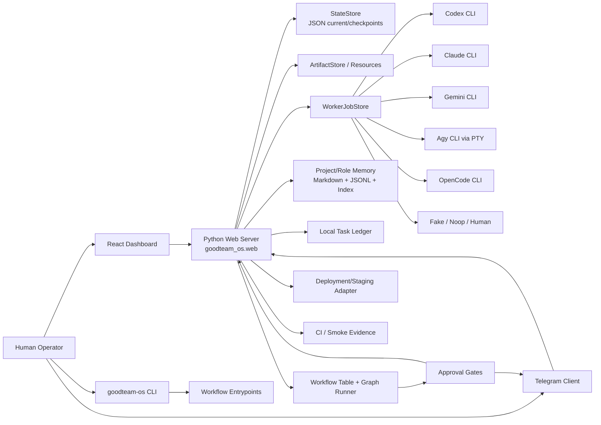
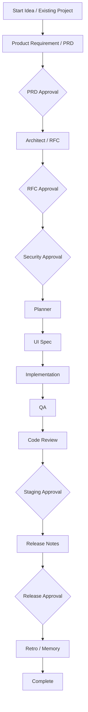
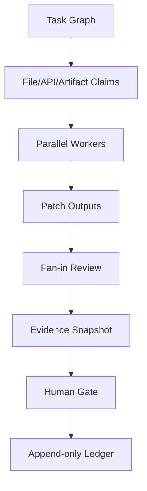
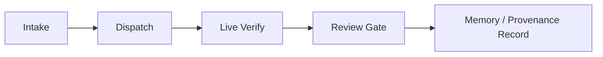
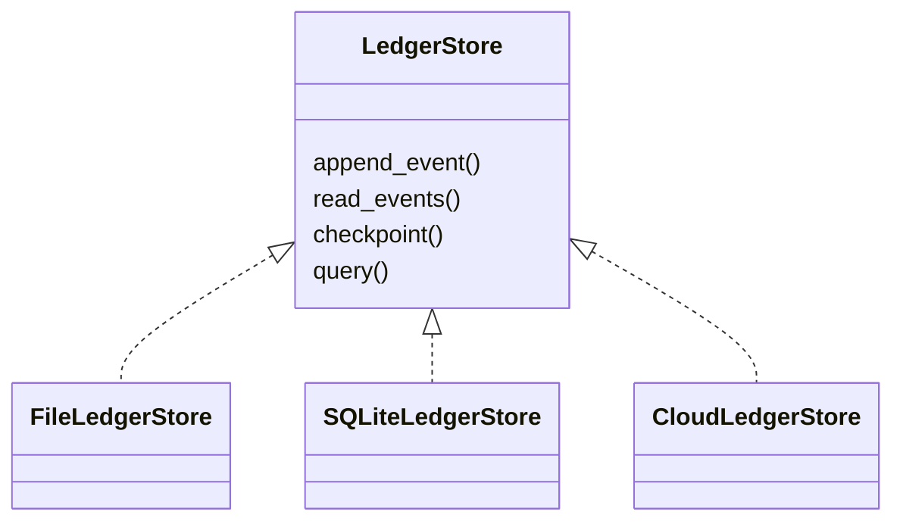
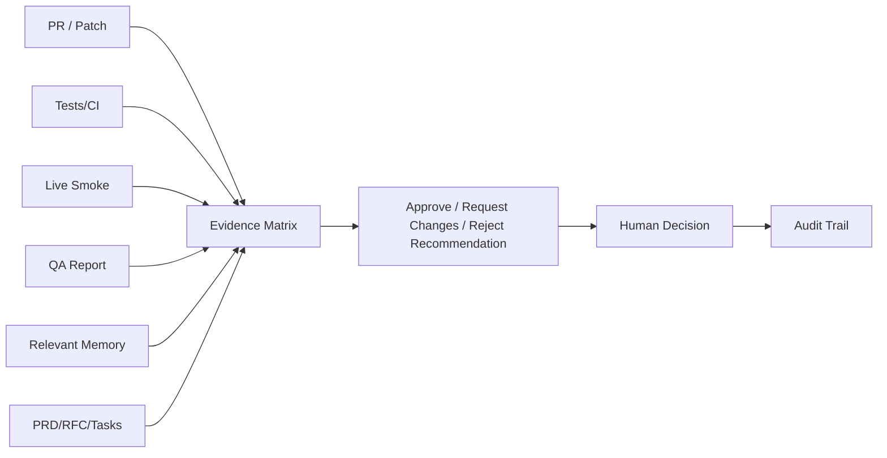
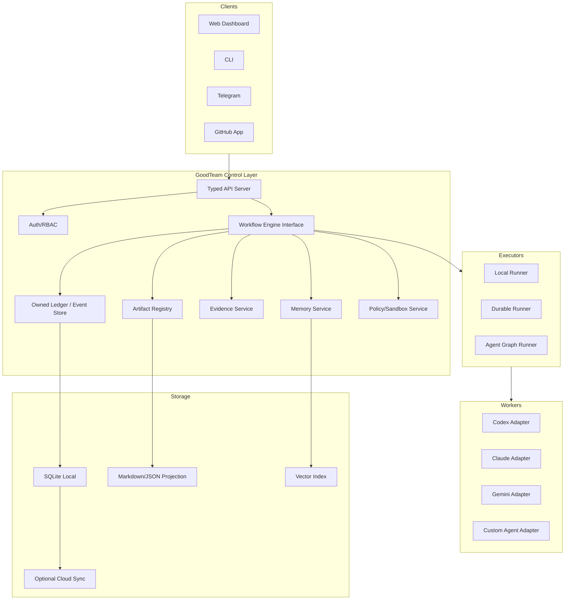

# GoodTeam Architecture and Commercialization Review

## Executive summary

GoodTeam is best understood as a local-first control layer for AI-assisted software delivery, not as another coding agent. Its strongest product direction is the owned engineering-organization protocol: workflow ledger, role chain, approval gates, evidence snapshots, provenance, review workbench, memory, and replaceable worker/tool adapters.

The current implementation has a strong product thesis and several promising foundations, but it is still early as a commercial multi-agent system. The most important gaps are durable workflow execution, worker isolation, API/server structure, mature RAG engineering, real multi-agent fan-out/fan-in, and a lighter default product workflow.

The recommended strategy is to keep GoodTeam's ledger, evidence model, role/artifact contracts, approval semantics, and provenance-first memory as first-party moat areas, while replacing or abstracting commodity infrastructure such as web framework, workflow runtime, vector indexing, UI primitives, auth/secrets, and sandbox execution with mature components.

## Current architecture



### Backend

The backend is a Python package exposed through `goodteam-os`. It currently uses a lightweight local-first file ledger and a stdlib HTTP server. The server coordinates workflow state transitions, APIs, file-system interactions, approvals, staging, Telegram notifications, memory retrieval, and worker dispatch.

Important backend modules:

- `goodteam_os.cli`: CLI entrypoint for start, serve, init, doctor, board, workers, failure-patterns, smoke, dispatch, memory append, and Telegram polling.
- `goodteam_os.web`: dashboard server, API surface, workflow/API coordination, approval handling, Telegram notification coordination, and local server actions.
- `goodteam_os.graph`: artifact generation, project context gathering, project memory/task ledger initialization, and workflow execution helpers.
- `goodteam_os.workflow_table`: declarative gate transitions, workflow nodes, load profiles, dependency validation, topology plan generation, and failure dispositions.
- `goodteam_os.state`: JSON-backed state and checkpoint persistence.
- `goodteam_os.workers`: worker job protocol and CLI adapter registry.
- `goodteam_os.memory`: project memory, role memory, memory event WAL, markdown projections, BM25/optional embedding retrieval, supersession, and pickup packets.
- `goodteam_os.dispatch`: parallel dispatch helper for role/adapter/task tracks.
- `goodteam_os.tasks`: local task ledger and lightweight board.

### Frontend

The frontend is a React/Vite dashboard with Tailwind and lucide icons. It is already separated from the backend in development through a proxy and can be served as static assets by the Python backend in production mode.

The current frontend should be treated as a product dashboard prototype that has grown into a review workbench. It needs stronger component, form, table, API, and state-management foundations before the review and evidence surfaces grow much further.

## Current workflow model

GoodTeam uses role contracts and artifact contracts rather than a free-form group chat. The main value is artifact handoff plus human gates plus evidence and memory.



The role set currently includes Orchestrator, Project Intake, Research, Product Requirement, Architect, Review, Planner, UI, Implementation, QA, Code Review, Release, and Retro Memory.

The workflow table already has a useful declarative foundation:

- `GateTransition` models approval, changes-requested, and rejection edges.
- `WorkflowNode` models a runner function, guard gate, retry/error behavior, and dependencies.
- `LoadProfile` allows different workflow profiles.
- The `greenfield` profile covers the heavy lifecycle.
- The `fix` profile is a lighter path for fix work.

This is a good direction. The important next step is to make the execution layer durable, resumable, interruptible, and safe for real parallel workers.

## Memory and RAG architecture

### Current memory layout

```mermaid
flowchart TD
  ProjectRoot[Target Project Root] --> GoodTeamDir[.goodteam/]
  GoodTeamDir --> ProjectMemory[memory/project-memory.md]
  GoodTeamDir --> RoleMemory[memory/roles/{role}/]
  RoleMemory --> LT[long-term.md]
  RoleMemory --> MT[mid-term.md]
  RoleMemory --> ST[short-term.md]
  RoleMemory --> Events[events.jsonl]
  RoleMemory --> Index[index.json]
  RoleMemory --> Embeddings[embeddings.jsonl optional]
```

GoodTeam has two memory layers:

1. Project memory: durable project-level facts in `.goodteam/memory/project-memory.md`.
2. Role memory: per-role long-term, mid-term, short-term markdown projections plus `events.jsonl`, `index.json`, and optional local embedding cache.

The best architectural idea here is the WAL-plus-projection model. Memory events are appended to JSONL, projected into markdown for human review, and summarized/indexed for machine retrieval. This is better than only writing mutable markdown because it gives the system a durable event trail.

### Retrieval

Current retrieval is event-level retrieval. It uses BM25 by default, with optional local fastembed embeddings. Retrieval returns stable `mem:<id>` handles so artifacts can cite memory events.

This is not yet commercial-grade RAG, but the provenance direction is strong. GoodTeam should not become a generic knowledge-base chatbot. It should become a provenance-first engineering memory system that can answer questions like:

- Which prior job produced this lesson?
- Which human approval allowed this decision to move forward?
- Which PR, task contract, research note, or review rationale caused this memory?
- Is this memory superseded?
- Did the current task conflict with prior project conventions?

### Cross-project memory

Cross-project retrieval exists by resolving project configs, loading each target runtime root, and retrieving same-role memory events across selected projects. This is commercially promising because cross-project engineering lessons and failure patterns can compound into a team-level moat.

The current implementation is still lightweight. It needs stronger metadata, tenant/project isolation, retrieval evaluation, permissioning, and quality scoring.

## Strengths

### 1. Clear differentiated product thesis

GoodTeam is not trying to be another agent UI. It is trying to own the engineering delivery protocol around agents. That is the right layer to build a durable product.

### 2. Ledger, gates, evidence, and provenance are real moats

Approval gates, evidence snapshots, review decisions, provenance, and memory citations are more valuable for commercial engineering teams than raw autonomous code generation. The direction is right: make AI work reviewable, attributable, and reversible.

### 3. Replaceable worker adapters

The worker registry supports multiple external CLI agents. This avoids premature lock-in to one model provider and keeps GoodTeam positioned as the coordinator rather than the model vendor.

### 4. Local-first is a strong early wedge

Local files, markdown, JSONL, and project-local `.goodteam` state are easy to inspect, diff, back up, and debug. This is ideal for founder-led dogfooding, power users, and privacy-sensitive early adopters.

### 5. Role/artifact contracts are more useful than agent chat

A structured chain of PRD, RFC, task breakdown, implementation result, QA report, code review, staging report, release notes, and retro memory is much more operationally useful than a room of agents chatting.

### 6. Dogfooding evidence is unusually strong

The project documents failures found by live smoke, review, and real usage. That is a good sign. The product should continue to make GoodTeam-on-GoodTeam the forcing function for architecture decisions.

## Weaknesses and architectural risks

### P0: Workflow execution is still immature

The workflow table is useful, but commercial multi-agent orchestration needs durable execution:

- resume after crash
- cancel / retry / timeout semantics
- human wait states
- fan-out / fan-in
- idempotent node execution
- queue-backed workers
- per-node ownership and write domains
- replayable audit log
- compensation/rollback paths

Current workflow execution is closer to a hand-written state machine plus declarative tables. That is acceptable for local-first v0, but not enough for commercial-grade multi-agent delivery.

Recommendation: keep the GoodTeam ledger first-party, but abstract the runner. Support the current local runner, then evaluate a durable runner such as Temporal for team/cloud mode and a graph runner such as LangGraph only as a replaceable execution projection, not as the source of truth.

### P0: Worker execution uses dangerous permissions

Current CLI adapters run external coding agents with broad local authority. This is acceptable only for explicit local/dev mode. It is not commercially acceptable without sandboxing, least privilege, path policies, command policies, secrets isolation, and patch-based review.

Recommendation:

- Treat dangerous worker mode as dev-only.
- Add a policy layer before every worker run.
- Use git worktrees or isolated sandboxes per worker.
- Require file ownership/write-domain claims.
- Prefer patch outputs and fan-in review before merge.
- Add command allowlists/denylists.
- Move secrets into a brokered secret provider rather than ambient env access.

### P0: The web server is becoming a god module

`goodteam_os.web` currently coordinates too many responsibilities. It should not continue to absorb API routing, workflow transitions, file-system actions, Telegram integration, staging, memory, approval logic, and server actions in one module.

Recommendation:

- Migrate the API layer to FastAPI or another mature typed web framework.
- Introduce typed request/response schemas.
- Split routes by domain: projects, runs, approvals, artifacts, memory, workers, tasks, staging, server actions.
- Move business logic into services that are testable without HTTP.
- Add auth middleware and OpenAPI contracts.

### P1: Agent cooperation is still mostly serial handoff

GoodTeam currently coordinates roles through artifacts and gates. This is good, but it is not yet rich multi-agent collaboration.

Missing capabilities:

- parallel work with real isolation
- fan-in review and merge planning
- conflict detection before writes
- role-to-role challenge/response
- structured debate that can update artifacts safely
- agent capability registry
- per-agent performance/failure memory
- dynamic task graph mutation

Recommendation: build a collaboration DAG around claims, patches, fan-in review, evidence, and human gates.



### P1: RAG is lightweight and unevaluated

The memory system has a good provenance foundation, but retrieval quality is not yet engineered to commercial standards.

Missing capabilities:

- vector index abstraction
- hybrid search with metadata filters
- document chunking strategy
- reranking
- retrieval evaluation
- source permissions
- memory quality scoring
- decay/promotion policy
- conflict detection
- tenant/project isolation
- grounding checks

Recommendation: keep the memory ledger and provenance model first-party, but plug in mature retrieval infrastructure.

### P1: Default workflow is too heavy for many real tasks

The full PRD/RFC/security/staging/release chain is valuable for high-risk work, but it is too heavy as the default for everyday bugfixes and small increments.

Recommendation: make the minimal chain the default:



Then expose load profiles:

1. Fast Fix: intake -> dispatch -> verify -> review -> record.
2. Feature Increment: PRD-lite -> plan -> implementation -> QA -> release.
3. Full Lifecycle: PRD -> RFC -> security -> staging -> release.

### P1: Commercial team features are not yet present

Local-first is a strong early wedge, but a commercial product eventually needs:

- multi-user identity
- RBAC
- organization/workspace model
- GitHub App integration
- PR status checks
- shared review queue
- SSO
- audit retention policy
- cloud sync/control plane
- secret management
- usage and cost accounting

Recommendation: keep local-first as the base mode, but design a cloud/control-plane architecture early enough that local data models do not block it.

### P2: File-system state will hit scaling limits

JSON/Markdown/JSONL files are great for local inspectability, but weak for concurrent writes, queries, migration, audit aggregation, and team dashboards.

Recommendation: define a storage interface now.



A practical next step is SQLite/WAL as the local primary store, with markdown as a human-readable projection.

### P2: Artifact/resource model needs immutability semantics

State already has both legacy artifacts and resource descriptors. This suggests an in-progress migration. Before the review workbench grows further, GoodTeam needs a precise artifact protocol:

- Is an artifact immutable after gate review?
- What artifact hash did the human approve?
- Does editing an artifact invalidate a gate?
- Does evidence snapshot lock to artifact digest?
- Are PRs linked to artifact versions?
- Can memory cite artifact versions?

Recommendation: make artifacts immutable by default, versioned explicitly, and approval targets hash-addressed.

## What GoodTeam should not build from scratch

### Web/API framework

Do not continue expanding stdlib HTTP routing for commercial features. Use FastAPI, Pydantic, OpenAPI, middleware, and typed request/response contracts.

### Durable workflow runtime

Do not rebuild all durable workflow concerns inside ad-hoc state transitions. Keep GoodTeam's ledger first-party, but evaluate Temporal or similar for durable execution in team/cloud mode. LangGraph can be considered as an agent graph executor, but it should not own the ledger.

### Vector/RAG infrastructure

Do not build a vector database, reranker, ingestion engine, and retrieval evaluator from scratch. Keep GoodTeam's memory protocol and provenance model first-party, but use or support mature stores such as Qdrant, LanceDB, Chroma, sqlite-vec, or pgvector.

### UI primitives

Do not hand-roll complex tables, forms, dialogs, tabs, tooltips, virtual lists, and graph controls. Use mature UI primitives and data libraries such as Radix/shadcn, TanStack Query, TanStack Table, React Hook Form, Zod, and React Flow where appropriate.

### Auth, secrets, and sandboxing

Do not build security primitives casually. Use OS keychain/1Password/Doppler/Vault/AWS/GCP secret managers where appropriate. Use Docker/devcontainer/Firecracker/e2b-like isolation or at least git worktree plus path and command policy before treating workers as production-safe.

## What GoodTeam should deepen as its moat

### 1. Engineering-organization protocol

This is the core product:

- role contracts
- artifact contracts
- approval gates
- evidence snapshots
- review workbench
- provenance graph
- memory citations
- human decision trail
- adapter boundaries

### 2. Evidence-backed Review Workbench

The review workbench should become the main commercial surface.



The product should not merely say, "the agent is done." It should say:

- what changed
- why it changed
- which contract authorized it
- which tests and smoke checks prove it
- what memory was relevant
- what risks remain
- who approved it
- what can be rolled back

### 3. Provenance-first memory

The memory system should optimize for engineering accountability, not generic Q&A.

Prioritize:

- memory event source links
- artifact/job/review/PR provenance
- supersession and stale-fact handling
- failure pattern learning
- cross-project lessons
- retrieval citations
- memory quality gates

### 4. Agent adapter and capability registry

The worker registry should evolve into a capability registry:

- supported agent backend
- model choices
- auth readiness
- sandbox requirements
- cost profile
- reliability history
- best task types
- failure patterns
- allowed write domains
- required verification commands

### 5. GoodTeam-on-GoodTeam dogfood loop

The most valuable product signal is using GoodTeam to build GoodTeam. The minimal loop should be first-class:

1. capture issue or idea
2. create scoped contract
3. dispatch isolated worker
4. run live smoke/evidence
5. review and decide
6. record provenance/memory
7. use that memory next time

## Recommended target architecture



Principles:

1. GoodTeam owns the ledger and protocol.
2. Workflow runners are replaceable.
3. Memory is provenance-first.
4. Workers are sandboxed by default.
5. Review workbench is the primary commercial surface.
6. Local-first remains the base mode, with optional cloud/control-plane sync.

## Prioritized roadmap

### P0: Next 2-4 weeks

1. Worker safety boundary
   - Mark dangerous mode as explicit local/dev mode.
   - Add write-domain/path policy.
   - Add command policy.
   - Prepare worker-isolated worktree/sandbox design.

2. Web/API decomposition
   - Split `goodteam_os.web` by routes and services.
   - Define typed schemas for approvals, artifacts, workers, memory, projects, and server actions.
   - Prepare FastAPI migration path.

3. Artifact immutability protocol
   - Add artifact version/digest.
   - Bind approval decisions to artifact digest.
   - Invalidate or fork approvals when artifact content changes.

4. Minimal chain default
   - Make intake -> dispatch -> verify -> review -> record the primary dogfood path.
   - Keep full lifecycle as a load profile.

5. Memory retrieval evaluation
   - Create golden retrieval cases.
   - Measure recall, citation correctness, stale-memory suppression, and cross-project retrieval relevance.

### P1: Next 1-2 quarters

1. Storage interface and SQLite local store.
2. Worker sandbox/fan-in review.
3. RAG backend abstraction and hybrid retrieval.
4. Workflow engine abstraction.
5. Frontend component/data-layer hardening.
6. GitHub App integration for PR checks and provenance links.

### P2: Commercial productization

1. Multi-user organizations and RBAC.
2. Shared review queue.
3. Cloud sync/control plane.
4. Enterprise auth/secrets integration.
5. Agent capability registry.
6. Cross-project memory product surface.
7. Usage, cost, and reliability analytics.

## Final verdict

GoodTeam has the right product thesis and several valuable foundations. It should not compete as a generic coding agent or generic agent framework. Its strongest future is as the engineering control plane that makes AI-generated software work reviewable, auditable, memory-backed, and safe enough for real teams.

The core moat should be:

- owned ledger
- approval/evidence workbench
- provenance-first memory
- role/artifact contracts
- pluggable agent adapters
- dogfood-driven delivery loop

The main architectural danger is continuing to grow all infrastructure in-house. The project should aggressively reuse mature infrastructure for API framework, durable execution, RAG indexing, UI primitives, auth/secrets, and sandboxing, while investing deeply in the GoodTeam-specific protocol layer.
