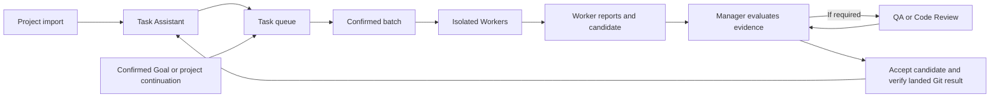

# GoodTeam Architecture

GoodTeam coordinates repeated engineering iterations in a local project.
Projects imports a repository and records its readiness. Work owns the Task
Assistant conversation, draft and queue. Team configures project Roles and
Workers. Knowledge shows repository understanding and project memory.

## Task intake and authority

The Task Assistant stages chat requests or saves new tasks in the queue.
Selecting a queued task prepares its exact revision. Manager recommendations
enter the same queue after an explicit action. A project continuation uses
the same path within the authorized task inventory and budget.

Batch admission verifies the selected revisions, original task cards, Team
configuration, execution scope and available capacity. It saves the
confirmation and execution identity before launching Workers. A retry reads
the same identity and the saved dispatch receipts.

See [project task batches](project-task-batches.md) and
[project continuation](project-continuation.md).

## Worker isolation and evidence

The batch adapter uses the shared dispatch pool. Each writing Worker runs in
a retained Git copy and records the actual changed paths. The pool applies
write-domain and capacity checks before dispatch. A batch can enter review
only when its required job results can be attributed to the original tasks.

Optional batch quality checks bind the candidate commit to host-run checks
and independent Reviewer reports. A bounded correction uses that evidence
and requires its own admission. Delivery binds the landed Git revision to
the reviewed candidate and an explicit human decision. The Work page reads
batch and job state. It never grants dispatch authority from a status badge
or a conversation message.

See [batch quality](project-batch-quality.md),
[batch recovery](project-batch-recovery.md) and
[execution identity](execution-identity.md).

## Durable records

| Record | Owner |
| --- | --- |
| Imported project and readiness | `project_registry.py`, `project_readiness.py` |
| Conversation, drafts, queue and batch confirmations | `task_assistant_session.py` |
| Original task cards and status | `tasks.py` |
| Worker jobs and dispatch receipts | `workers.py`, `dispatch.py` |
| Candidate evidence and independent review | `project_iteration_quality.py`, `execution/` |
| Project and Role memory | `memory.py`, `memory_core/` |

The [testing strategy](testing-strategy.md) defines verification for changes
to these boundaries.
