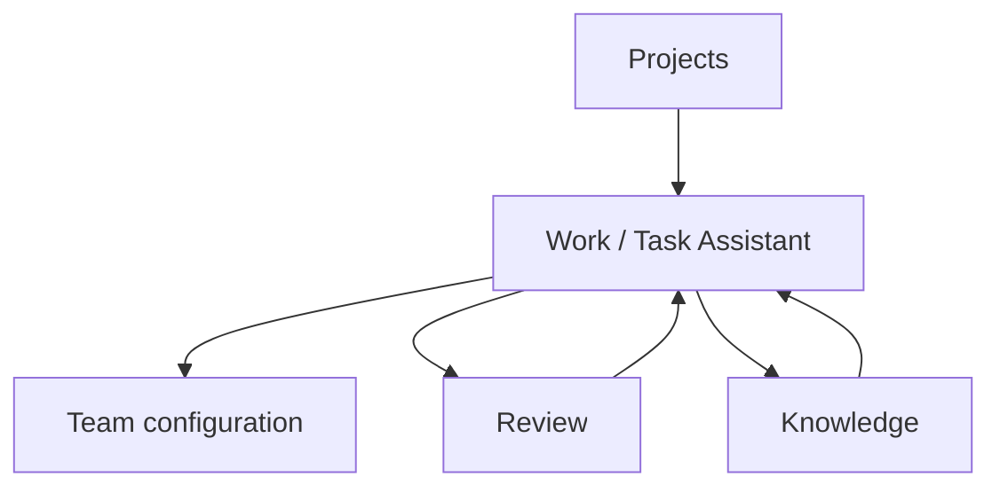
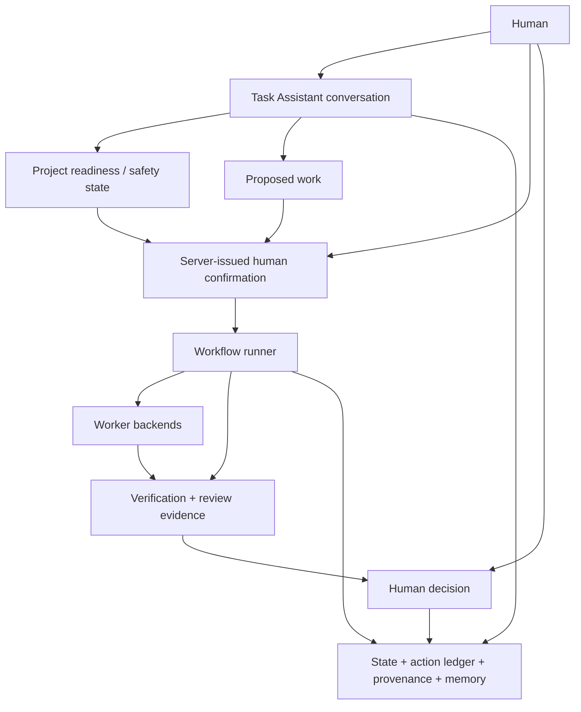
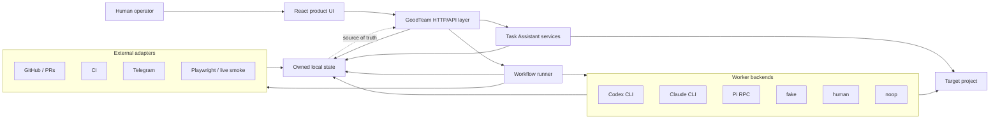
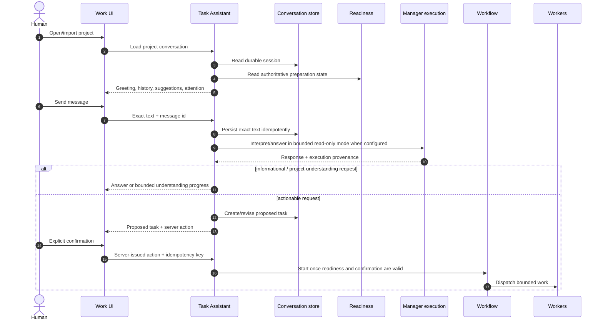
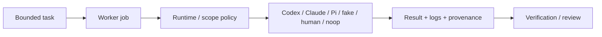
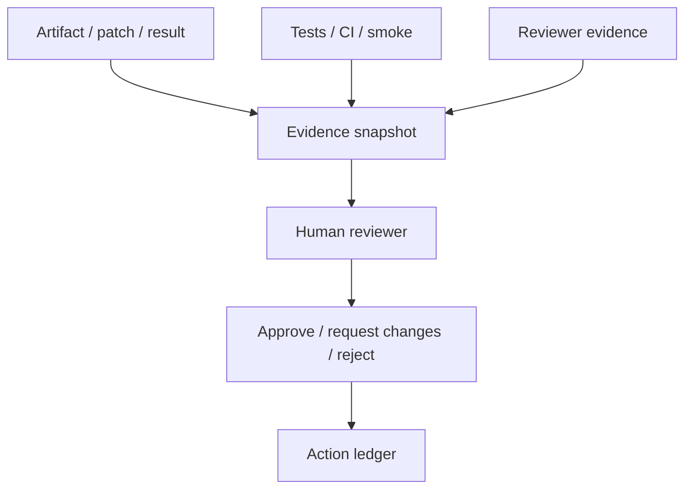
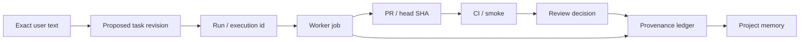

# GoodTeam Architecture

GoodTeam is a local-first control layer for AI-assisted software delivery. It owns workflow state, human decision authority, evidence, artifacts, provenance, and project memory. External coding agents, GitHub, CI, Telegram, and browser automation are adapters: they perform work or produce evidence, but they do not own GoodTeam's source of truth.

This document describes the architecture that is current on `main`. Historical design context lives in `docs/plans/`, `docs/current-progress.md`, `docs/backlog.md`, and `docs/archive/`. For the short current-state summary, see [`status.md`](status.md).

## Product interaction model

The current user journey is chat-first:

`/projects/<PROJECT_KEY>/work` is the primary interaction surface. Task Assistant / 任务助手 handles ordinary project understanding, questions, clarification, work intake, progress, retry, and server-authorized actions in one project-scoped conversation. Team, Review, and Knowledge remain dedicated detail workbenches.

Legacy Project Home, Inbox, Activity, and Settings product surfaces have been retired. Compatibility redirects remain, but they are not part of the current product architecture.

## Control-plane boundary

Task Assistant is a conversational layer over GoodTeam-owned state, not an autonomous source of authority.

Key invariants:

- Readiness remains backend-owned even though it is no longer a separate user journey.
- User text is preserved exactly in the project conversation and proposed-task history.
- Model interpretation can explain or classify intent, but it cannot authorize readiness or workflow mutations.
- Consequential actions use server-issued action IDs and explicit human confirmation.
- Pre-confirmation model execution is read-only or fails closed.
- Worker and reviewer outputs are advisory evidence; humans remain approval authority.
- Conversation, workflow, and worker persistence is durable and project-scoped.

## System context

## Current component responsibilities

| Module / area | Responsibility |
| --- | --- |
| `src/goodteam_os/web.py` | HTTP API, product projections, server-authorized mutations, review/approval entrypoints, and integration glue. |
| `src/goodteam_os/task_assistant.py` | Project-scoped conversational intake and routing around authoritative readiness/workflow state. |
| `src/goodteam_os/task_assistant_session.py` | Durable conversation, proposed-task, attention, and workflow-binding persistence. |
| `src/goodteam_os/manager_execution.py` | Executes configured Task Assistant model turns with runtime-policy provenance while preserving human authority. |
| `src/goodteam_os/project_readiness.py` | Backend-owned project preparation and safety state used behind the chat-first experience. |
| `src/goodteam_os/team_workspace.py` | Projects the conversation and workflow/runtime events into the Work experience. |
| `src/goodteam_os/graph.py` | Workflow progression, gates, worker scheduling, and run advancement. |
| `src/goodteam_os/state.py` | Durable workflow state, checkpoints, approval decisions, and project current state. |
| `src/goodteam_os/workers.py` | Worker backend registry, job store, dispatch packets, runtime state, logs/results, and backend readiness. |
| `src/goodteam_os/memory.py` | Project-local and role-scoped memory, WAL events, retrieval, and pickup context. |
| `src/goodteam_os/tasks.py` | Local project task ledger. |
| `src/goodteam_os/projects.py` | Project config discovery and root resolution. |
| `src/goodteam_os/staging.py` | Delivery contract and staging acceptance evidence. |
| `frontend/` | React product UI for Projects, Work, Team, Review, and Knowledge. |
| `.goodteam/` under target projects | Project-owned tasks, memory, provenance, worker-job data, and Pi session data where configured. Task Assistant conversation persistence is not stored here. |

`web.py` is still a broad integration module. New business rules should prefer focused services with tests instead of further concentrating domain logic in HTTP handlers.

## Project conversation and workflow start

The durable Task Assistant session is workspace-scoped at `state/projects/<PROJECT_KEY>/task-assistant-session.json`; it is deliberately not written into the imported repository.

The same project conversation remains visible before, during, and after workflow execution. Starting a run binds workflow identity to the existing conversation instead of replacing onboarding history.

## Worker execution model

Worker adapters execute bounded jobs. GoodTeam owns job identity, runtime policy, result handling, retry semantics, and evidence lineage.

The current configuration model supports project defaults and role-oriented overrides. See [`config-reference.md`](config-reference.md) and [`worker-backends.md`](worker-backends.md) for the implemented contract.

## Approval and evidence model

Reviewer provenance, recommendations, and policy severity improve decision quality but remain advisory. Approval authority stays with the human operator unless a future explicit product contract says otherwise.

## Identity and provenance

A delivery should remain traceable across issue/task intent, conversation messages, workflow execution, worker jobs, branch/PR, CI, review decisions, and memory.

Loose or inferred identity must not bind evidence to a different run, artifact version, PR, or retry attempt.

## Memory model

GoodTeam keeps owned project-local memory and provenance so future work can recover prior decisions and evidence without treating external tools as the durable record. See [`memory-model.md`](memory-model.md) and [`provenance-ledger.md`](provenance-ledger.md).

## Current vs active design

### Implemented current contract

- Projects → Work / Team / Review / Knowledge product structure.
- Task Assistant as the primary project interaction surface.
- Backend-owned readiness hidden behind the conversational journey.
- Durable project-scoped Task Assistant session and exact user-text preservation.
- Configurable Task Assistant execution with bounded pre-confirmation policy.
- Human-authorized workflow start and approval decisions.
- Pluggable worker backends and durable worker job evidence.
- Review evidence, provenance, project memory, and risk-tiered verification.

### Active design, not yet stable contract

- **Role → TeamRole → Worker** separation, including independent role enablement and runtime worker lifecycle/history.
- Broader control-plane UX for enabling/inactivating roles and initializing/releasing workers.
- Deeper parallel worker fan-out/fan-in and dynamic collaboration graphs.

Do not document these active-design items as implemented until their domain model, persistence, migration, and invariant tests land.

## Documentation boundary

Stable architecture and operator/reference manuals live directly under `docs/`. Historical plans, progress snapshots, audits, and research are evidence, not current contracts. See [`README.md`](README.md) for the documentation lifecycle and [`archive/README.md`](archive/README.md) for archival rules.
