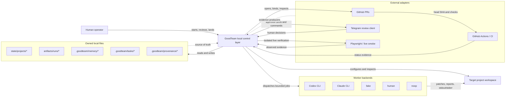
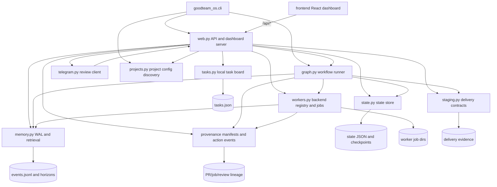
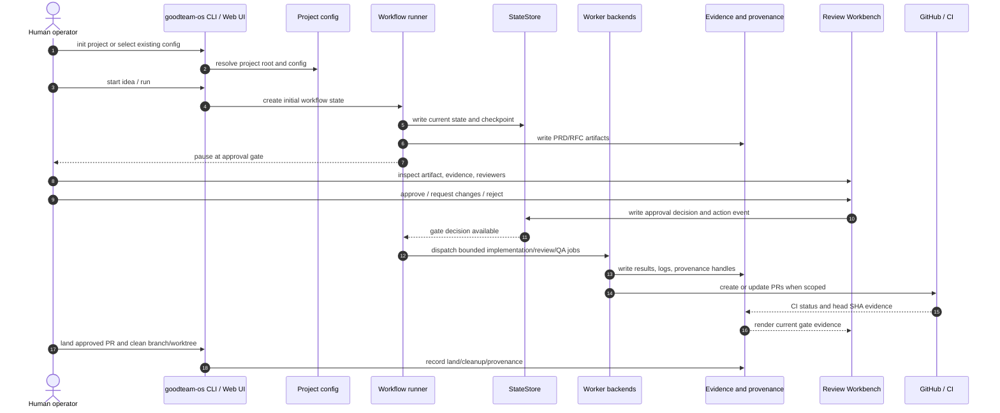
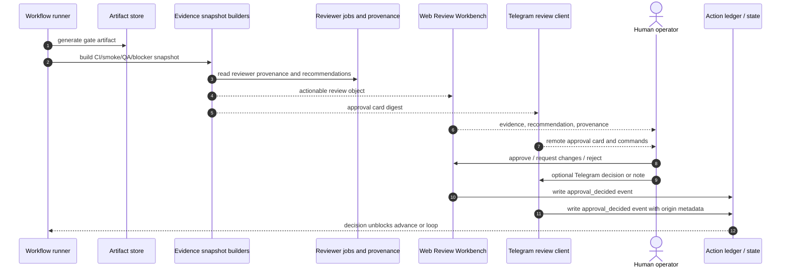
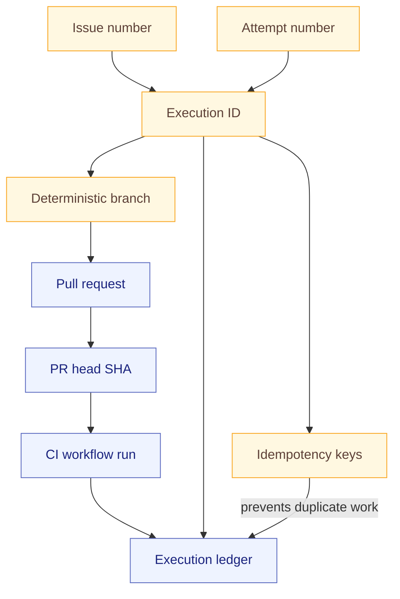
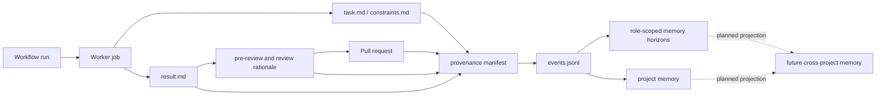

# GoodTeam Architecture

GoodTeam is a local-first control layer for AI software delivery. It owns the
workflow ledger, approval state, artifacts, memory, and provenance. External
systems such as GitHub, CI, Telegram, Playwright, and coding agents are adapters:
they produce evidence or perform bounded work, but they do not own GoodTeam's
source of truth.

This document is a stable architecture overview. Historical design context lives
in `docs/plans/`, `docs/product-vision.md`, `docs/current-progress.md`, and
`docs/backlog.md`.

## System Context

Key rule: the GoodTeam ledger remains authoritative. Adapters can fail, retry,
or be replaced without changing the ownership model.

## Component Architecture

## Module Responsibilities

| Module / area | Responsibility |
| --- | --- |
| `src/goodteam_os/cli.py` | CLI entry point for init, start, serve, doctor, and inspection commands. |
| `src/goodteam_os/web.py` | HTTP API, dashboard state projection, approval decisions, review workbench helpers, and same-origin guarded actions. |
| `src/goodteam_os/graph.py` | Workflow progression, gate transitions, worker scheduling, and run advancement. |
| `src/goodteam_os/state.py` | Durable run state, approval decisions, checkpoints, and project current state. |
| `src/goodteam_os/workers.py` | Worker backend registry, job store, dispatch packets, stdout/stderr/result handling, and backend readiness. |
| `src/goodteam_os/memory.py` | Project-local and role-scoped memory, WAL events, retrieval, and pickup context. |
| `src/goodteam_os/staging.py` | Delivery contract configuration and staging acceptance evidence. |
| `src/goodteam_os/tasks.py` | Local task board projection and task persistence. |
| `src/goodteam_os/projects.py` | Project config discovery and root resolution. |
| `src/goodteam_os/telegram.py` | Telegram commands, approval cards, remote review sessions, and decision notes. |
| `frontend/` | React dashboard that consumes `/api/*` and renders project state, approvals, workers, memory, and Dev Loop surfaces. |
| `.goodteam/` under target projects | Project-owned tasks, memory, provenance, and local GoodTeam state artifacts. |

## End-To-End Workflow

## Approval And Evidence Model

Recommendations and reviewer outputs are advisory. The human decision remains the
approval authority.

## Execution Identity And PR/CI Binding

This identity chain is why execution and binding tests are stricter than normal
helper tests. Loose identifiers can bind evidence to the wrong work.

## Memory And Provenance Graph

The current moat is ownership: project-local state, artifacts, and memory are
portable files. The roadmap is compounding: every delivery should make future
runs cheaper, faster, and better grounded.

## Current vs Planned Boundary

```mermaid
flowchart TD
    Current[Implemented now]
    Planned[Planned or gated]

    Current --> LocalLedger[Local state, checkpoints, action events]
    Current --> ApprovalGates[Human approval gates]
    Current --> WorkerRegistry[Pluggable worker backend registry]
    Current --> ReviewWorkbench[Review Workbench evidence surfaces]
    Current --> TelegramReview[Telegram remote supervision]
    Current --> TestingStrategy[Risk-tiered verification strategy]

    Planned --> VisualDocs[Full visual docs system]
    Planned --> OperatorGuide[Stable operator guide]
    Planned --> ConfigReference[Config reference]
    Planned --> LiveSmokePlaybook[Live smoke playbook]
    Planned --> CrossProjectMemory[Cross-project memory]
    Planned --> RealParallelWorkers[Real parallel worker fan-in]
    Planned --> WebExplainer[Dashboard /docs or /explainer route]
```

When changing architecture docs, keep this boundary explicit. Do not document
planned behavior as if it already exists.
