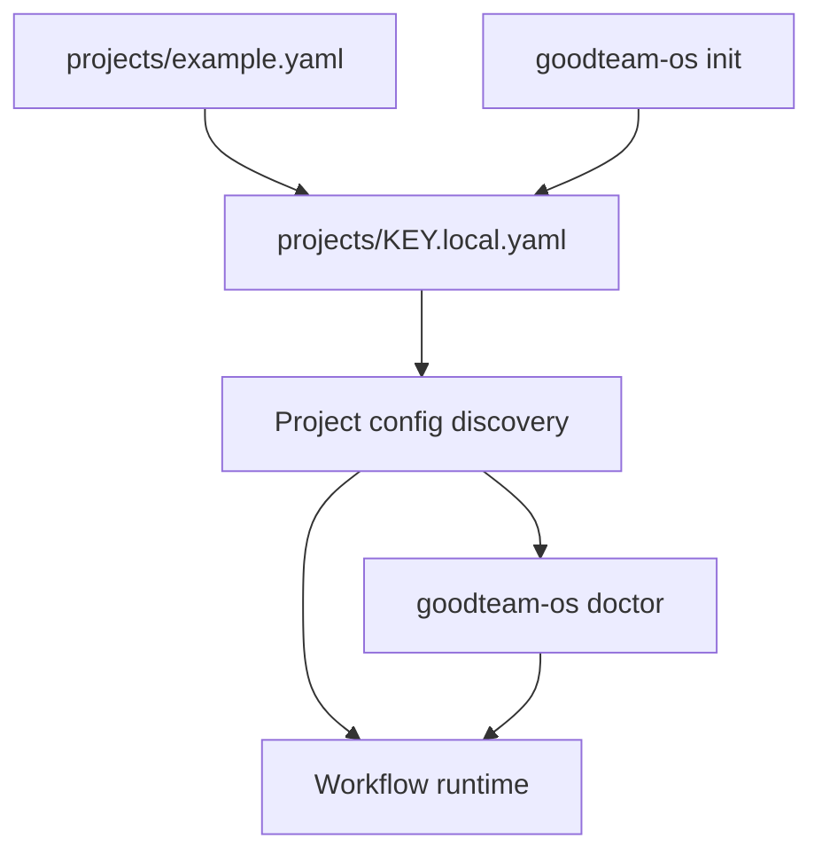

# Project Config Reference

GoodTeam project config files describe how GoodTeam should operate against a
specific target project. They are local-first: the committed reference template is
`projects/example.yaml`, while machine-specific project configs should usually be
copied to `projects/<key>.local.yaml` so private paths stay untracked.

This is a stable reference for the config concepts that exist today. For the
canonical example, keep `projects/example.yaml` as the source of truth.

## Config Lifecycle



## Minimal Config

```yaml
name: Example App
key: EXAMPLE
model_profile: balanced
delivery_mode: custom
source_type: existing_project
repos:
  root: /absolute/path/to/your/repo
worker_backend:
  mode: fake
task_backend:
  mode: local
delivery_contract:
  required: false
```

## Top-Level Fields

| Field | Required | Purpose |
| --- | --- | --- |
| `name` | Yes | Human-readable project name. |
| `key` | Yes | Stable project key used in routes, state, artifacts, and memory references. |
| `model_profile` | Usually | Model routing profile, such as `balanced`. See `models.yaml`. |
| `delivery_mode` | Usually | Delivery shape, such as `mvp`, `existing_project`, `feature_increment`, or `custom`. |
| `delivery_standards` | Optional | Project-specific quality standards written as nested key/value entries. |
| `source_type` | Usually | Whether the target is a `new_project` or `existing_project`. |
| `repos` | Yes | Named local repository paths GoodTeam may inspect or write. |
| `worker_backend` | Yes | Default worker backend mode. |
| `workers` | Optional | Per-role worker backend overrides. |
| `task_backend` | Usually | Local task ledger backend. |
| `providers` | Optional | Provider credential metadata for doctor checks. |
| `delivery_contract` | Optional | Functional evidence requirements before release/staging decisions. |

The parser currently supports a small indentation-based YAML subset: each
non-comment line is either `key: value` or a `key:` that opens a nested block. Do
not assume full YAML list syntax is available unless parser support is extended.

## Identity Fields

### `name`

A readable name shown to operators.

```yaml
name: Example App
```

### `key`

A short stable identifier. Use uppercase or simple alphanumeric keys when
possible.

```yaml
key: EXAMPLE
```

The key is operationally important because dashboards, state lookups, memory, and
project-scoped actions can use it. Avoid renaming it after a project has active
state unless you intentionally migrate that state.

## Delivery Shape

### `delivery_mode`

Examples from the reference template:

```yaml
delivery_mode: custom
```

Known modes include:

```text
mvp
init_project
multi_service
static_site
cli_tool
library
data_pipeline
mobile_app
feature_increment
custom
```

Use `custom` when none of the named modes describes the target well enough.

### `delivery_standards`

Delivery standards are project-specific contract reminders.

```yaml
delivery_standards:
  standard_0001: Deliver a locally runnable first slice with documented setup and verification commands.
  standard_0002: Preserve the host project's existing contracts and include focused regression tests.
  standard_0003: Record rollout, rollback, and follow-up risks in the handoff.
```

They should be written as concrete expectations, not vague aspirations.

## Source Type

```yaml
source_type: existing_project
```

Use `existing_project` when GoodTeam is working against a pre-existing repo. Use
`new_project` when GoodTeam is expected to scaffold a new target.

## Repositories

```yaml
repos:
  root: /absolute/path/to/your/repo
```

`repos` maps names to absolute local paths. For most targets, `root` is enough.
For multi-service projects, split paths by service or surface when that makes
worker scope and evidence clearer.

Examples:

```yaml
repos:
  root: /absolute/path/to/app
```

```yaml
repos:
  docs: /absolute/path/to/app/docs
  backend: /absolute/path/to/app/server
  frontend: /absolute/path/to/app/client
```

Operator rules:

- Use absolute paths in local configs.
- Keep `.local.yaml` out of git when paths reveal private machine details.
- Confirm the dashboard project key before approving or dispatching work.

## Operator CI Gate

Known-project Issue automation must declare every check context that is required
before review, Telegram approval, or merge. The values must match GitHub check-run
names exactly:

```yaml
required_checks:
  backend: backend
  frontend: frontend
```

When this mapping is omitted, the operator queries protected required-status
contexts from the configured base branch. If neither source provides a non-empty
set, preflight fails closed. A check that has not appeared yet remains missing;
an unrelated successful check never satisfies this gate.

## Worker Backend

The global default is configured under `worker_backend.mode`:

```yaml
worker_backend:
  mode: fake
```

Reference modes:

| Mode | Purpose |
| --- | --- |
| `fake` | Credential-free deterministic smoke and first-run demos. |
| `anthropic` | Drives the `claude` CLI when Anthropic credentials are ready. |
| `codex` | Drives the `codex` CLI when Codex credentials are ready. |
| `pi` | Drives an optional persistent Pi RPC session; `pi-rpc` is an alias. |
| `noop` | Produces no real worker execution. Useful for disabled paths. |

Per-role overrides live under `workers`:

```yaml
workers:
  ui: fake
  implementation: codex
  qa: fake
```

Anything omitted falls back to `worker_backend.mode`.

Use `goodteam-os doctor` after changing worker backends. Doctor should surface
missing CLIs, missing credentials, or known auth traps before a dispatch fails.

## Task Backend

```yaml
task_backend:
  mode: local
```

The local task ledger lives under the target repo's `.goodteam/` directory. This
keeps project work inspectable without requiring an external tracker.

## Providers

Provider entries are optional and are primarily used for readiness checks.

```yaml
providers:
  anthropic:
    type: anthropic
    api_key_env: ANTHROPIC_API_KEY
    env_file: .env
```

Do not commit secrets. Reference environment variable names or local env files;
keep actual credentials outside version control.

## Delivery Contract

```yaml
delivery_contract:
  required: false
```

A delivery contract declares that functional evidence is required before the
project can pass later gates. Keep contract requirements concrete enough that an
operator can decide whether the evidence satisfies them.

## Config Safety Checklist

```text
Project key is stable and unique.
Repo paths point to the intended target.
Private machine paths live in .local.yaml.
Worker backend mode matches available credentials.
Doctor was run after backend/provider changes.
Delivery standards are concrete.
Delivery contract requirements are not vague.
No secrets are committed.
```

## Related Docs

- [`worker-backends.md`](worker-backends.md)
- [`operator-guide.md`](operator-guide.md)
- [`live-smoke-playbook.md`](live-smoke-playbook.md)
- [`testing-strategy.md`](testing-strategy.md)
