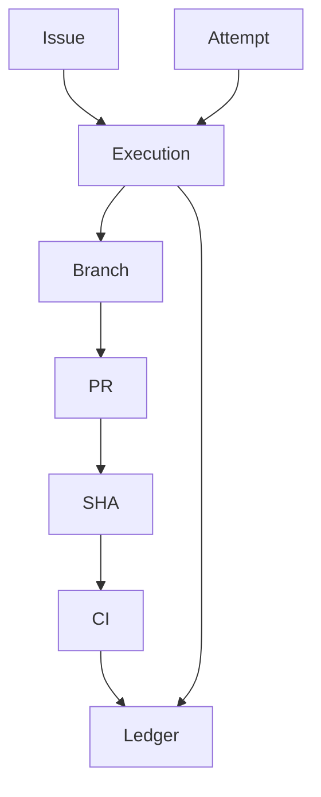

# Execution Identity Reference

GoodTeam uses execution identity to link issue → attempt → branch → PR → CI → ledger.

## Identity Chain

## Components

- Issue: user intent
- Attempt: single run
- Execution ID: groups all artifacts
- Branch: workspace
- PR: GitHub representation
- SHA: commit under test
- CI: verification results
- Ledger: final record

## Why It Matters

- Prevents mixing evidence across runs
- Ensures CI matches correct code
- Makes approvals traceable

## Idempotency

Same execution ID must not create conflicting state.

## Failure Modes

- wrong SHA bound
- mixed runs in ledger
- missing attempt tracking

## Related

- worker-backends.md
- config-reference.md
- operator-guide.md
