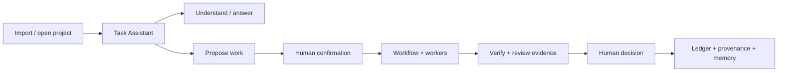
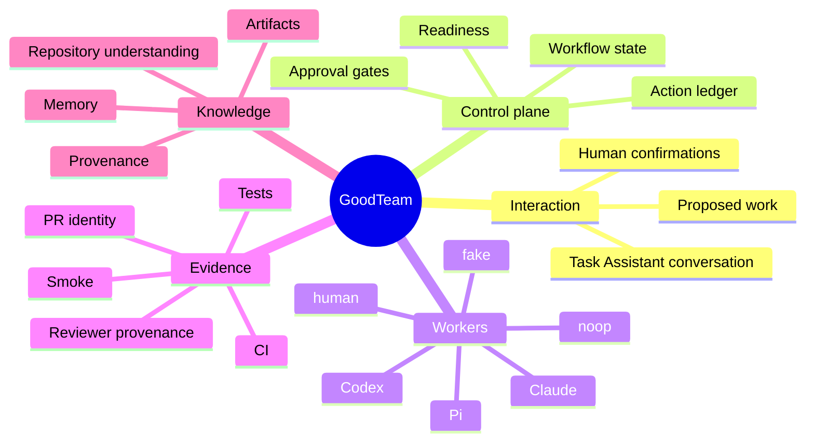
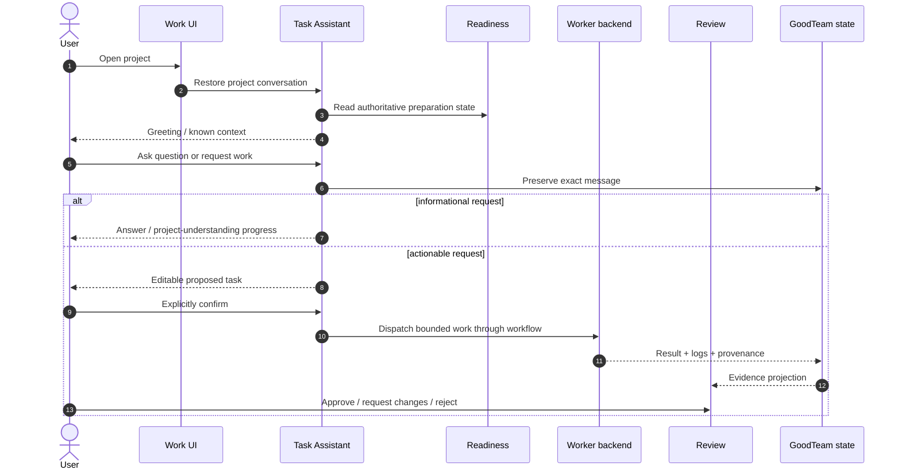

# GoodTeam Explainer

GoodTeam is a local-first AI engineering team OS. It coordinates project understanding, specialized AI workers, review evidence, CI, human decisions, provenance, and memory through one owned control plane.

This is a concise introduction for new users, contributors, and design partners. For the current product snapshot, see [`status.md`](status.md). For implementation architecture, see [`architecture.md`](architecture.md).

## The short version

Most AI coding tools optimize a single agent interaction. GoodTeam optimizes the **delivery system around agents**.

The current experience starts with a project conversation, not with a form-heavy workflow wizard:



Task Assistant is the primary user-facing command surface, but it is not the source of authority. GoodTeam keeps readiness, workflow transitions, worker scope, approval decisions, and evidence binding in the backend control plane.

## What the user sees

The canonical product surface is:

```text
Projects → Work / Team / Review / Knowledge
```

- **Projects**: import or open a local project.
- **Work**: talk to Task Assistant, understand the project, propose work, follow progress, retry, and continue the same project conversation across runs.
- **Team**: inspect and configure the project's AI execution setup.
- **Review**: inspect evidence and make explicit human approval decisions.
- **Knowledge**: inspect repository understanding, artifacts, and memory.

Legacy Home, Inbox, Activity, and Settings pages are retired product surfaces. Compatibility redirects remain for old bookmarks.

## Why Task Assistant matters

A user should not have to understand GoodTeam's internal readiness state machine before asking useful questions.

For example, a user can simply ask:

```text
先帮我了解一下这个项目。
```

or:

```text
修复登录后偶发跳回首页的问题。
```

GoodTeam preserves the exact user text, interprets it in context, and chooses a safe path:

- answer from existing project evidence,
- advance bounded read-only project understanding,
- ask for one clarification when needed,
- create an editable proposed task,
- surface a server-issued confirmation action,
- or explain a configuration/readiness problem.

The model may help interpret intent, but it does not gain authority to start consequential work by itself.

## What GoodTeam owns



External tools are replaceable adapters. GoodTeam's owned state is the durable record of what was requested, what ran, what evidence existed, and why a human allowed the workflow to continue.

## A normal interaction



The conversation remains project-scoped and continuous. Starting a workflow does not erase the onboarding discussion or replace the user's original request with a model rewrite.

## Why gates still matter

Chat-first does not mean approval-free.

At a consequential gate, the user should be able to answer:

- What exactly am I approving?
- Which user request or task revision led here?
- Which worker ran, under which policy?
- What tests, CI, smoke, or reviewer evidence exists?
- Is any recommendation advisory or blocking?
- What will happen if I approve, request changes, or reject?

GoodTeam's goal is not maximum autonomy. It is **legible, bounded automation with explicit human authority**.

## What makes it local-first

Local-first means the project record is owned and inspectable. GoodTeam keeps durable state and evidence in local project/workspace data rather than treating a chat transcript or external SaaS as the only memory of what happened.

Depending on the feature, that includes:

- workflow state and checkpoints,
- Task Assistant session/history,
- worker job state and results,
- artifacts and repository-understanding output,
- approval/action history,
- task ledgers,
- provenance records,
- project and role memory.

Cloud tools can still participate, but they remain adapters.

## What GoodTeam is not

GoodTeam is not:

- a group chat where autonomous agents freely mutate a project,
- a model provider,
- a replacement for GitHub or CI,
- an approval system where reviewer models silently make final decisions,
- a UI that requires users to manually drive every internal state transition.

It is the owned protocol connecting intent, execution, evidence, and human judgement.

## Active design boundary

The next control-plane evolution is separating **Role → TeamRole → Worker** so capability definitions, team enablement, and actual runtime worker instances can have independent lifecycle and history. That work is active design, not a current stable contract. Until it lands, stable references describe the implemented role-oriented worker configuration.

## How to read the repository

For a new contributor:

1. [`../README.md`](../README.md) — setup and broad project overview.
2. [`status.md`](status.md) — what the product looks like now.
3. [`README.md`](README.md) — documentation authority and map.
4. [`architecture.md`](architecture.md) — current system boundaries.
5. [`testing-strategy.md`](testing-strategy.md) — verification expectations before changing behavior.

Historical plans and progress logs are useful for understanding why the system evolved, but they should not be treated as the current contract unless a stable manual links to them explicitly.
