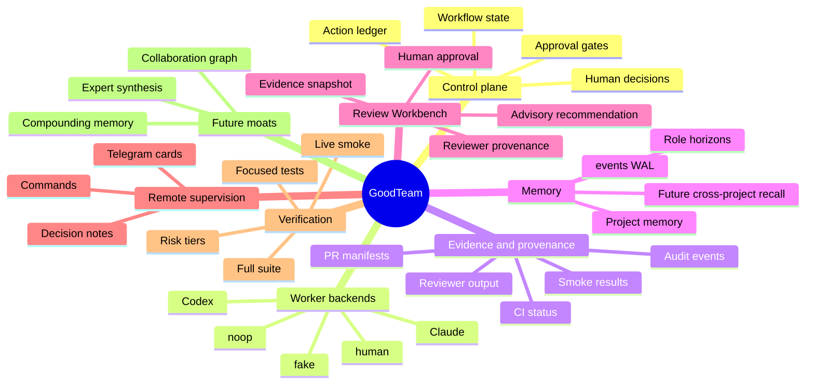
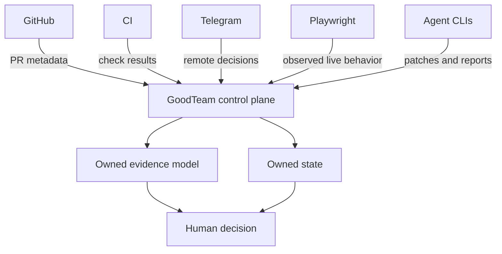
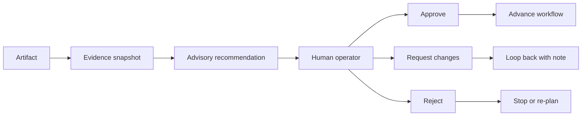
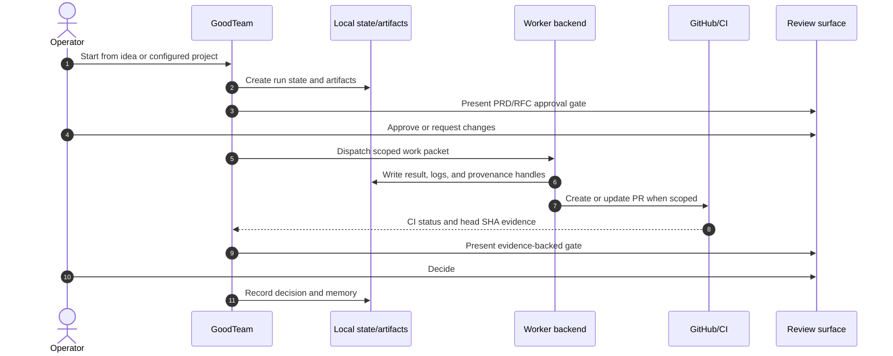
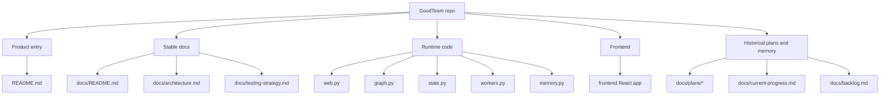

# GoodTeam Explainer

GoodTeam is a local-first AI engineering team OS. It coordinates specialized AI
workers, project tools, CI, review evidence, and memory into one workflow ledger
that a human can inspect and approve.

This page is written as a concise, visual introduction for new users,
contributors, and design partners. For implementation details, see
[`architecture.md`](architecture.md). For PR verification policy, see
[`testing-strategy.md`](testing-strategy.md).

## The Short Version

Most coding tools optimize one agent. GoodTeam optimizes the delivery system
around many agents.

A delivery is not just code. A delivery includes product intent, architecture,
implementation, QA, review, CI evidence, approval, release, and memory. GoodTeam
turns those steps into an owned local protocol:

```mermaid
flowchart LR
    Idea[Idea] --> PRD[PRD]
    PRD --> RFC[RFC / architecture]
    RFC --> Gate1[Human gate]
    Gate1 --> Build[Implementation workers]
    Build --> QA[QA and review]
    QA --> Evidence[CI / smoke / provenance evidence]
    Evidence --> Gate2[Human gate]
    Gate2 --> Land[Land and cleanup]
    Land --> Memory[Record memory]
    Memory --> Next[Next delivery is sharper]
```

The human stays in charge. The system collects evidence, runs bounded workers,
and makes the decision surface legible.

## What GoodTeam Owns

## The Control-Plane Idea

GoodTeam does not try to replace every tool. It gives the tools a protocol.

External tools are replaceable adapters. GoodTeam's ledger is the durable record
of what happened and why a human approved it.

## Why Gates Matter

Autonomous coding without review can create fast ambiguity. GoodTeam adds
explicit gates where the system must stop and explain itself.

At a gate, the operator should be able to answer:

- What artifact am I approving?
- What changed since the last gate?
- Which tests, CI checks, smoke results, or reviewer findings exist?
- Is the recommendation advisory or blocking?
- What happens if I approve, request changes, or reject?

## What Happens During A Run

## What Makes It Local-First

Local-first does not mean disconnected. It means owned.

GoodTeam can use cloud or networked tools when the operator chooses them, but the
source of truth remains under local project files:

- workflow state and checkpoints,
- generated artifacts,
- worker job results,
- approval action events,
- task ledgers,
- memory events,
- provenance manifests.

This matters because engineering organizations need to answer not only "what did
the agent change?" but also "why was that change accepted?"

## How To Read The Repo

For a new reader, start with:

1. [`../README.md`](../README.md) for setup and product overview.
2. [`docs/README.md`](README.md) for the docs map.
3. [`architecture.md`](architecture.md) for the system model.
4. [`testing-strategy.md`](testing-strategy.md) before contributing changes.

## Web Explainer Direction

This document is intentionally written so it can later become a dashboard route
such as `/explainer` or `/docs`. The first useful version should stay Markdown
only, so the diagrams and narrative are reviewable as source.

A future UI slice can adapt this page into a product-facing explainer if the
dashboard needs an onboarding surface for operators or design partners.
