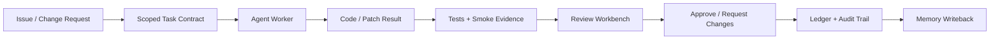
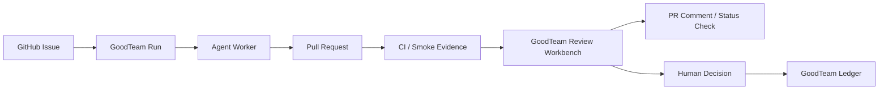

# Fundraising Readiness Sprint Plan

## Purpose

This sprint turns GoodTeam from a promising technical project into a fundable company narrative with a repeatable demo, clear product wedge, dogfood evidence, and a short-term roadmap that investors and design partners can understand.

The goal is not to build every enterprise feature. The goal is to prove that GoodTeam can become the control plane for AI software engineering teams: the system that makes coding-agent work reviewable, auditable, evidence-backed, memory-aware, and safe enough for real teams.

## Fundraising thesis

GoodTeam should not be pitched as another coding agent. It should be pitched as the AI engineering control plane.

Core narrative:

> Coding agents are becoming software contributors. Engineering teams now need governance, review, evidence, memory, and auditability around those agents. GoodTeam owns that engineering-organization protocol while Codex, Claude Code, Gemini, GitHub, CI, deployment tools, and issue trackers remain replaceable adapters.

## Sprint duration

Recommended duration: 4-6 weeks.

- 4 weeks if the goal is a sharp angel/pre-seed narrative and demo.
- 6 weeks if the goal is to also recruit design partners and produce early usage evidence.

## Sprint outcomes

By the end of the sprint, GoodTeam should have:

1. A 5-8 minute investor demo path.
2. A product thesis document that clearly says what GoodTeam is and is not.
3. A review-workbench-centered demo flow.
4. Three dogfood case studies.
5. A GitHub-native workflow story, at least as a documented roadmap and preferably with a thin integration.
6. A worker safety roadmap with at least local/dev dangerous mode called out explicitly.
7. A 30/60/90 day investor roadmap.
8. A first-pass pitch deck outline.
9. A target design-partner list and outreach script.
10. A repo-level fundraising evidence packet.

## Non-goals

Do not spend this sprint building a generic multi-agent platform.

Do not try to compete directly with Cursor, Devin, Claude Code, Codex, or GitHub Copilot.

Do not build full enterprise security, full cloud sync, full RBAC, full SSO, or a complete workflow runtime during this sprint.

Do not over-expand the workflow surface. The sprint should compress the product into one strong story: agent work enters GoodTeam, GoodTeam produces evidence-backed review, human approval, and durable memory.

## Product wedge

The first fundable wedge should be:

> Evidence-backed review workbench for AI-generated software changes.

This is narrower and more fundable than "multi-agent engineering OS" because it attaches to a concrete pain:

- teams already use coding agents;
- AI-generated changes are hard to review;
- engineering leaders need proof, ownership, and auditability;
- repeated agent mistakes should become memory;
- the organization needs a safe gate before code reaches production.

## Primary demo flow

The investor demo should fit into 5-8 minutes.

Recommended demo script:

1. Start with a real issue: "Fix a broken login flow and add regression coverage."
2. GoodTeam creates a scoped task contract.
3. A worker agent makes the change.
4. GoodTeam runs verification commands.
5. The Review Workbench shows changed files, test evidence, remaining risks, relevant memory, and approval choices.
6. Human approves or requests changes.
7. GoodTeam records the decision in the ledger.
8. GoodTeam writes a memory event so future similar tasks can retrieve the lesson.

The demo should make the product feel like an engineering control plane, not a code generator.

## Sprint phases

## Phase 1: Positioning and product narrative

Target duration: Week 1.

### Goals

- Make GoodTeam's positioning immediately understandable.
- Remove ambiguity around whether GoodTeam is an agent, IDE, workflow tool, or governance layer.
- Produce repo-native documents that can become pitch deck inputs.

### Deliverables

1. `docs/product-thesis.md`
   - One-line positioning.
   - Problem statement.
   - Why now.
   - What GoodTeam owns.
   - What remains an adapter.
   - Target customer.
   - Initial wedge.
   - Expansion path.
   - Explicit non-goals.

2. README top-section refinement
   - Keep technical quick start, but sharpen the first screen for product clarity.
   - Add a short "Not another coding agent" section.
   - Add a "GoodTeam owns the protocol; agents are adapters" diagram.

3. `docs/fundraising-narrative.md`
   - Fundraising story in investor language.
   - Problem, market shift, product wedge, moat, roadmap, ask.

### Acceptance criteria

- A new reader can understand GoodTeam's product category in under 60 seconds.
- The first README screen answers: what is it, who is it for, why now, and what is unique.
- The project no longer sounds like a generic multi-agent coding tool.

## Phase 2: Investor demo path

Target duration: Week 1-2.

### Goals

- Create a fast, repeatable demo that shows the full GoodTeam loop.
- Compress the existing 30-minute demo into a fundable 5-8 minute story.
- Make the demo safe to run repeatedly.

### Deliverables

1. `scripts/investor-demo.sh`
   - Creates or resets an isolated demo workspace.
   - Uses a deterministic or bounded worker mode where needed.
   - Starts GoodTeam dashboard.
   - Seeds a realistic issue or change request.
   - Produces artifacts, evidence, approvals, and memory handles.

2. `docs/investor-demo.md`
   - Prerequisites.
   - Demo setup.
   - Demo script.
   - Expected outputs.
   - Troubleshooting.
   - Screens to show in order.

3. Demo seed scenario
   - A realistic issue, preferably a bugfix or small feature.
   - Clear acceptance criteria.
   - Verification commands.
   - Expected review decision.

### Acceptance criteria

- Demo can be run from a clean checkout with documented prerequisites.
- Demo reaches a Review Workbench or approval screen reliably.
- Demo produces at least one artifact, one verification/evidence record, one approval decision, and one memory/provenance record.
- Demo can be explained in 5-8 minutes without opening implementation files.

## Phase 3: Review Workbench as the hero surface

Target duration: Week 2-3.

### Goals

- Make the Review Workbench the product's most compelling surface.
- Show that GoodTeam is the place where AI work becomes inspectable and governable.

### Required review fields

The review surface should clearly show:

- task or artifact contract;
- agent or worker that produced the change;
- changed files or output summary;
- verification commands and results;
- test/smoke evidence;
- relevant memory references;
- risks and uncovered areas;
- approval decision;
- decision origin and actor;
- audit trail entry.

### Deliverables

1. Review Workbench screen refinement
   - Prioritize evidence matrix and decision panel.
   - Reduce visual noise.
   - Make approval state and required action obvious.

2. Evidence summary component
   - Shows pass/fail/unknown for tests, smoke, lint, build, and manual review.

3. Memory/provenance panel
   - Shows relevant `mem:` handles and why they matter.

4. Decision panel
   - Approve.
   - Request changes.
   - Reject.
   - Add note.
   - Attach evidence snapshot.

### Acceptance criteria

- A viewer can understand what the agent did and why it is safe or unsafe to approve.
- Review decision is visibly tied to evidence.
- Memory and provenance feel like core product value, not hidden implementation details.
- The page is screenshot-worthy for a pitch deck.

## Phase 4: Dogfood evidence and case studies

Target duration: Week 3-4.

### Goals

- Produce credible evidence that GoodTeam helps build GoodTeam.
- Create investor-ready case studies with concrete before/after value.

### Case study template

Each dogfood case study should include:

1. Problem
2. Why it mattered
3. GoodTeam run or workflow used
4. Agent/backend used
5. Artifacts generated
6. Evidence collected
7. Human review decision
8. What risk was caught or reduced
9. Resulting code/doc change
10. Memory written back
11. Time saved or quality improvement estimate
12. Link to PR/run/artifact where applicable

### Deliverables

1. `docs/case-studies/goodteam-dogfood-001.md`
2. `docs/case-studies/goodteam-dogfood-002.md`
3. `docs/case-studies/goodteam-dogfood-003.md`

Suggested case study themes:

- Architecture review and documentation workflow.
- Worker safety or workflow gate improvement.
- Review Workbench or evidence flow improvement.

### Acceptance criteria

- At least three case studies exist.
- Each case study has specific artifacts and decisions.
- Each case study explains how GoodTeam changed the outcome versus using an agent directly.
- At least one case study shows GoodTeam catching or preventing a mistake.

## Phase 5: GitHub-native workflow story

Target duration: Week 4-5.

### Goals

- Make GoodTeam's place in real engineering workflows obvious.
- Investors and design partners should understand how GoodTeam connects to GitHub issues, PRs, checks, and reviews.

### Minimum version

A documented GitHub workflow is enough for fundraising readiness if implementation would exceed the sprint.

### Deliverables

1. `docs/github-workflow.md`
   - Issue-to-run flow.
   - Run-to-PR flow.
   - PR evidence collection.
   - GoodTeam review comment/status design.
   - Required GitHub permissions.
   - MVP implementation plan.

2. Optional thin implementation
   - Generate a PR review summary markdown.
   - Post-ready body format for a GitHub PR comment.
   - Status check naming convention.

### Acceptance criteria

- A design partner can understand where GoodTeam fits in their GitHub workflow.
- The MVP avoids overpromising full GitHub App capabilities if not yet implemented.
- The roadmap clearly separates local-first mode, GitHub-assisted mode, and future GitHub App mode.

## Phase 6: Safety, roadmap, and fundraising packet

Target duration: Week 5-6.

### Goals

- Remove obvious investor objections around safety and commercialization.
- Produce the final fundraising packet.

### Deliverables

1. `docs/worker-safety-roadmap.md`
   - Dangerous local/dev mode disclosure.
   - Worktree isolation plan.
   - Path/write-domain policy.
   - Command policy.
   - Secrets handling.
   - Patch-based review.
   - Future sandbox options.

2. `docs/roadmap-30-60-90.md`
   - 30-day demo and narrative goals.
   - 60-day design partner goals.
   - 90-day fundraising-readiness goals.

3. `docs/pitch-deck-outline.md`
   - 10-slide deck outline.
   - Suggested screenshot list.
   - Metrics to collect.
   - Demo story.

4. `docs/design-partner-outreach.md`
   - Ideal customer profile.
   - Discovery questions.
   - Outreach messages.
   - Call script.
   - Qualification criteria.

### Acceptance criteria

- Safety concerns are acknowledged rather than hidden.
- Roadmap is credible for a small team.
- Pitch deck outline can be turned into slides without rethinking the whole story.
- Outreach doc supports immediate design partner conversations.

## Suggested issue breakdown

### Product and positioning

- `docs: write GoodTeam product thesis`
- `docs: write fundraising narrative`
- `docs: sharpen README positioning`

### Demo

- `demo: add investor demo script`
- `docs: add investor demo walkthrough`
- `demo: seed realistic review-workbench scenario`

### Review Workbench

- `ui: make review workbench the hero demo surface`
- `ui: add evidence matrix summary`
- `ui: add memory and provenance panel to review flow`
- `ui: tighten approval decision panel`

### Evidence and memory

- `core: ensure demo run writes approval evidence snapshot`
- `core: ensure demo run writes memory event with provenance`
- `docs: add dogfood case study template`

### GitHub workflow

- `docs: define GitHub-native workflow MVP`
- `core: generate PR-ready GoodTeam review summary`
- `docs: define future GitHub App permissions and status checks`

### Safety

- `docs: write worker safety roadmap`
- `core: mark dangerous worker mode as local/dev only`
- `core: draft path/write-domain policy interface`

### Fundraising packet

- `docs: write 30/60/90 roadmap`
- `docs: write pitch deck outline`
- `docs: write design partner outreach plan`

## Investor metrics to collect during the sprint

Even if numbers are small, start collecting them now.

Product usage:

- number of GoodTeam runs;
- number of completed review gates;
- number of agent worker jobs;
- number of PRs or changes reviewed;
- number of tests/smoke checks attached as evidence;
- number of memory events written;
- number of repeated issues where memory was reused.

Quality:

- failures caught before merge;
- requested-changes decisions;
- test failures found by GoodTeam;
- stale or wrong memory events identified;
- agent output rejected by human review.

Speed:

- estimated human time saved;
- time from issue to review;
- time from review to merge;
- number of manual review steps reduced.

Adoption:

- design partner calls;
- pilots started;
- active weekly users;
- repeat usage;
- willingness to pay signals.

## Design partner discovery questions

Use these before pitching too hard:

1. Are your engineers already using coding agents?
2. Which tools are they using: Cursor, Codex, Claude Code, Copilot, Devin, custom agents?
3. How do AI-generated changes enter your normal review process?
4. Who is accountable when an agent breaks something?
5. How do you decide whether AI-generated code is safe to merge?
6. Do you track which tests, smoke checks, or deployment evidence justified a merge?
7. Do you have a way to remember repeated agent mistakes across projects?
8. Would a review workbench around AI-generated changes fit your process?
9. Would you prefer local-first, self-hosted, or SaaS?
10. What would make this product unacceptable for your team?

## Pitch deck outline

1. Title
   - GoodTeam: Control Plane for AI Software Engineering Teams.

2. Problem
   - Coding agents are becoming contributors, but teams lack governance, evidence, review, memory, and auditability.

3. Why now
   - Agent adoption is accelerating; enterprises now need safe rollout, measurable impact, and process integration.

4. Solution
   - GoodTeam turns agent work into scoped tasks, artifacts, evidence, human gates, ledger entries, and memory.

5. Demo
   - One issue through GoodTeam from task to evidence-backed approval.

6. Product architecture
   - GoodTeam owns the protocol; external tools are adapters.

7. Wedge
   - Evidence-backed review workbench for AI-generated software changes.

8. Expansion
   - Local-first pro -> team GitHub workflow -> enterprise governance/control plane.

9. Moat
   - Ledger, evidence graph, approval history, provenance-first memory, cross-project engineering memory.

10. Ask
   - Funding to reach design partner pilots, GitHub integration, sandboxed execution, and paid beta.

## Weekly plan

### Week 1

Focus: positioning and demo specification.

Deliver:

- product thesis;
- fundraising narrative;
- README positioning edit;
- investor demo spec;
- demo seed scenario.

Exit criteria:

- product story is understandable in under 60 seconds;
- demo can be described without implementation details.

### Week 2

Focus: demo path.

Deliver:

- investor demo script;
- demo walkthrough document;
- stable seeded run;
- expected artifacts/evidence list.

Exit criteria:

- demo can be repeated from a clean checkout;
- demo reaches review/approval state reliably.

### Week 3

Focus: Review Workbench.

Deliver:

- evidence matrix improvements;
- memory/provenance panel improvements;
- approval decision panel improvements;
- screenshot-ready review surface.

Exit criteria:

- one screenshot explains GoodTeam's core value.

### Week 4

Focus: dogfood evidence.

Deliver:

- three dogfood case studies;
- case study template;
- initial metrics log;
- first outreach list.

Exit criteria:

- at least three concrete examples show why GoodTeam is better than direct agent use.

### Week 5

Focus: GitHub workflow and safety roadmap.

Deliver:

- GitHub workflow MVP doc;
- worker safety roadmap;
- optional PR-ready review summary format;
- dangerous local/dev mode disclosure.

Exit criteria:

- design partners can see how GoodTeam fits their real engineering workflow;
- safety concerns have a credible roadmap.

### Week 6

Focus: fundraising packet.

Deliver:

- 30/60/90 roadmap;
- pitch deck outline;
- design partner outreach plan;
- demo video script;
- fundraising packet index.

Exit criteria:

- founder can start investor and design-partner conversations with a coherent packet.

## Final sprint acceptance criteria

The sprint is successful when all of the following are true:

1. GoodTeam has a clear product category: AI engineering control plane.
2. The repo has a documented investor demo that can be repeated.
3. The Review Workbench is visibly the hero product surface.
4. There are at least three dogfood case studies.
5. The project has a credible GitHub workflow story.
6. Worker safety concerns are explicitly documented with a roadmap.
7. A 30/60/90 roadmap exists.
8. A pitch deck outline exists.
9. A design partner outreach plan exists.
10. The founder can explain the company in one minute, show the product in eight minutes, and defend the next 90 days in detail.
