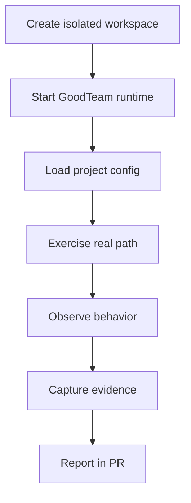
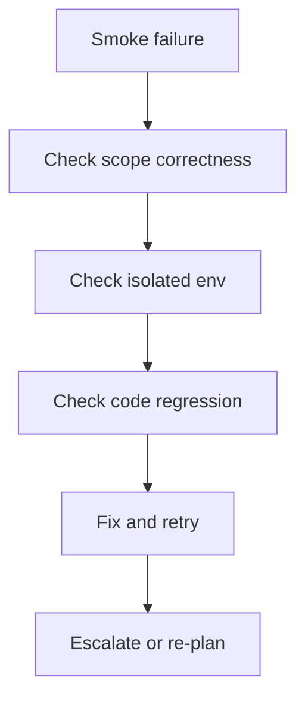

# Live Smoke Playbook

Live smoke is the highest-confidence verification tier in GoodTeam.
It validates real system behavior in an isolated environment where possible,
not just unit or integration assumptions.

This guide defines when to use live smoke, how to run it safely, and how to
report evidence.

Related docs:

- [`testing-strategy.md`](testing-strategy.md) for Tier 4 definition.
- [`operator-guide.md`](operator-guide.md) for operator workflow.
- [`architecture.md`](architecture.md) for system boundaries.

## When To Use Live Smoke

Use live smoke when the change touches any of the following:

- Browser-visible behavior (dashboard, UI routing, rendering).
- Adapter behavior (GitHub, CI, Telegram, Playwright).
- Worker dispatch execution paths.
- Workflow state transitions that depend on real runtime integration.
- Project root resolution or multi-project routing.

Do NOT use live smoke for:

- Pure documentation changes.
- Simple helpers or pure functions.
- Local formatting or lint fixes.

## Core Principle

```text
Never run mutating smoke commands against an active real project workspace.
```

All live smoke must be isolated or sandboxed when possible.

## Live Smoke Flow



## Example: Dashboard Smoke

```text
Goal: verify dashboard renders current gate and evidence correctly.

Steps:
1. Start server in isolated workspace.
2. Open /?project=<KEY>.
3. Confirm current gate is visible.
4. Confirm CI/evidence panel matches latest run.
5. No console errors.
```

Evidence to capture:

- URL used
- project key
- visible gate state
- evidence snapshot summary
- console logs (if any)

## Example: API Smoke

```text
Goal: verify /api/state reflects correct workflow state.

Steps:
1. Start API server in isolated workspace.
2. Trigger a small workflow run.
3. Query /api/state.
4. Confirm state matches expected transition.
```

Evidence:

- request/response logs
- state transition trace
- run ID

## Example: Worker Dispatch Smoke

```text
Goal: verify worker executes bounded task correctly.

Steps:
1. Dispatch a minimal task.
2. Observe worker backend execution.
3. Confirm output file or result artifact.
4. Confirm provenance entry is written.
```

Evidence:

- worker logs
- result artifact path
- provenance entry

## Failure Handling

If live smoke fails:



Do not repeatedly retry without understanding failure class.

## Evidence Requirements

A valid live smoke report should include:

- What was tested (explicit scope).
- How isolation was ensured.
- What was observed (not just "passed").
- Any logs or screenshots.
- Whether behavior matches expected contract.

## Anti-Patterns

Avoid:

- Running smoke directly on production-like or shared workspace.
- Treating unit test success as substitute for live smoke.
- Running smoke without capturing reproducible evidence.
- Mixing multiple unrelated checks in one smoke run.
- Reporting only "no errors" without context.

## Operator Responsibility

Live smoke is not fully automated trust. It is a verification tool for the
operator.

Even when smoke passes, the operator must still:

- confirm correct project context,
- confirm correct branch/run,
- confirm expected behavior matches spec,
- ensure no hidden side effects.

## Summary

Live smoke exists to catch the failures that unit tests and CI cannot see:

- routing issues,
- UI/state mismatches,
- adapter inconsistencies,
- runtime integration bugs.

It should be used sparingly, deliberately, and always with clear evidence.