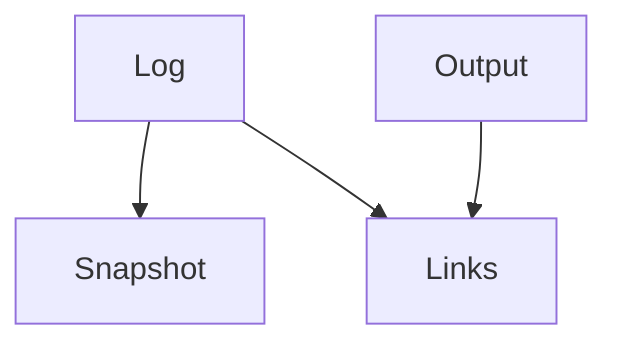

# Memory Model

GoodTeam stores run history in local files.

## Layers

## Log
Append-only record of actions.

## Snapshot
Current view built from the log.

## Output
Files produced during runs (reports, specs, results).

## Links
Connect outputs back to runs.

## Role View
Filtered view of log per role.

## Notes
Data is local and can be replayed.

## Related
- worker-backends.md
- config-reference.md
