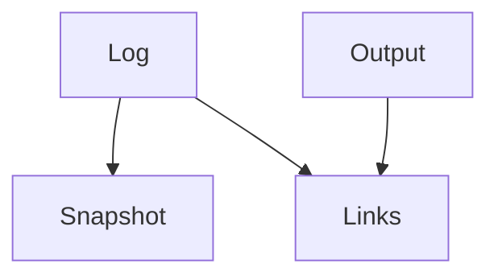

# Memory Model

GoodTeam stores run history in local files.

## Layers

## Log
Append-only record of actions.

## Snapshot
Current view built from the log.

## Output
Files produced during runs (reports, specs, results).

## Links
Connect outputs back to runs.

## Role View
Filtered view of log per role.

## Notes
Data is local and can be replayed.

## Cross-project search coverage

`GET /api/memory/cross` searches only the explicit project scope for the selected
role and query. Its existing `results` list is accompanied by `coverage`:

- `complete`: every distinct requested source was searched, including sources
  with no matching events.
- `partial`: some sources were searched and others could not be read.
- `unavailable`: no requested source could be read.
- `not_searched`: no search was requested (for example, a zero result limit).

Each entry in `coverage.sources` identifies the requested project and reports
`searched`, `unavailable`, or `not_searched`. Successful entries include
`match_count`, the number retrieved from that source before the global top-K
limit, not a count of every matching event. Unavailable entries expose only
`source_unavailable` (configuration/root unavailable or changed) or
`memory_unreadable` (the role's memory retrieval could not complete). Unknown
projects are not distinguished from unavailable configurations. No exception
text, private paths, or damaged record contents are included in these reasons.

The UI retains successful hits when other sources fail and can repeat the same
read with the original query and scope. Older responses without coverage are
shown as unverified coverage, never a confirmed complete empty search. Reading
does not repair memory, add records, or change source contents; the existing
store locking still applies. Coverage describes this search, not all project
context and not evidence that a Worker consumed the returned events.

Python callers using `cross_project_memory.retrieve` retain the list result;
callers needing source completeness use `retrieve_report`.

## Current context acceptance coverage

Baseline: `26253d10a1a5e9b72679a3bb1e889d00e587471d` (2026-10-12).
The bounded follow-up is tracked in [#524](https://github.com/LukeJiaoR/GoodTeam/issues/524),
under regression/claim calibration [#419](https://github.com/LukeJiaoR/GoodTeam/issues/419).

| Layer | Current evidence | Boundary |
| --- | --- | --- |
| Read-only input fidelity | [#522](https://github.com/LukeJiaoR/GoodTeam/pull/522) keeps exact-run captured delivery standards in Manager input after 41 discussion turns and a fresh service process. [#523](https://github.com/LukeJiaoR/GoodTeam/pull/523) carries saved custom workflow standards into first-PRD and UI/implementation/QA job inputs after restart. | Captured original input, legacy/workflow records and saved change feedback retain different source labels. Input presence does not prove model comprehension. |
| Correction invalidation and recovery | Four fresh Python processes exercised WAL capture, a two-step supersedes chain, old/new Worker input restoration and damaged-WAL reads. Frozen input drops invalidated events, retains still-active events and never adds later facts. New input/retrieval/citations use the final active facts. | Frozen packet bytes and historical events remain intact. Corrupt WAL produces unavailable input without cached facts or read-time repair. Fixtures are synthetic; no provider runs. |
| Actual execution effect | Not established by these checks. | Live Worker decisions, implementation, review/fix convergence and task acceptance still require real evidence under [#411](https://github.com/LukeJiaoR/GoodTeam/issues/411). Existing native-runtime restrictions remain unchanged. |

The existing memory provenance, pure-context compatibility and file-store suites
passed 93 focused tests in this run. The four-process chain found no product-code
defect; the accepted result is verification of existing behavior, not a new
memory implementation. These checks did not expand the conversation window, add
automatic compression or validate an external RAG/index service. Local active-event
retrieval was checked only for the synthetic query and facts in this chain.

See [file-store consistency](memory-file-store.md) for persistence/recovery limits
and [task input inspection](task-input-context-view.md) for input authority labels.
This coverage does not close the overall memory/context or product-effect goals.

## Knowledge browsing and execution audit

The role-memory list excludes `worker_failure:*` and `*/provenance` execution
records before ranking and applying the limit. `include_execution=true` on
`GET /api/memory/events` exposes those audit records; the page's checkbox stores
this choice in its URL. Superseded knowledge remains browsable and labelled.
Normal retrieval, generated summaries and the compatibility Markdown context
exclude execution records, while the WAL and Markdown files retain the audit.
Index and pickup provenance both carry the `knowledge_without_execution_v2`
retrieval policy, bound into the packet content digest. Missing/old/unknown pickup
policies invalidate frozen summaries and short-term text even with no retrieved
hits. Independently verified original hits may survive; consuming a frozen job
never retrieves newer facts, rewrites its packet, or changes its capture receipt.
New captures build context under the current policy.

The legacy prefix before the writer-owned `## Memory Events` appendix remains
compatible. The entire machine appendix is reconstructed in memory from the
captured eligible WAL events, including full multiline boundaries; embedded
headings and edited/unknown appendix notes are not treated as independent context.
Those original Markdown bytes remain on disk. This avoids guessing event
boundaries from individual lines or a source marker on only the final line.

When captured WAL or an explicit legacy source identifies execution records, the
appendix boundary must match the complete captured WAL projection. An edited or
ambiguous boundary withholds the entire legacy contribution and reports
`legacy_execution_unverifiable`; eligible WAL knowledge remains available. This
also covers embedded headings and legacy execution sources missing from WAL.
Original Markdown files and audit events are never rewritten by pickup filtering.

New Worker result writes retain the explicit `learned`, `caveats`, `decisions`,
or `open_questions` section as optional event `category`. Existing horizon
mapping, stable event IDs, text deduplication and private receipt schemas are
unchanged. A duplicate of an old uncategorized event stays historical/unclassified;
there is no retrospective category inference or automatic question resolution.
The list shows category, recorded time and original text (visually clamped).
Full original text, IDs, sources and correction links remain in the inspector.
No generated translation or additional model summary is involved.

## Related
- worker-backends.md
- config-reference.md
