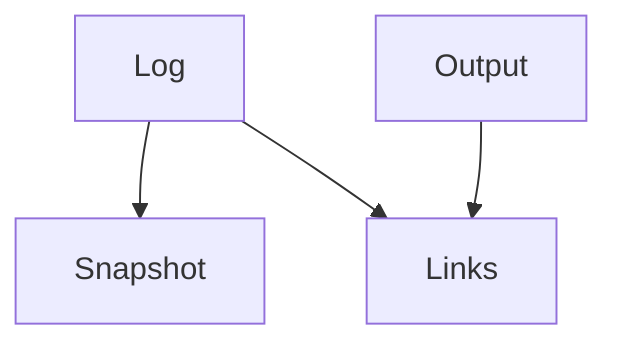

# Memory Model

GoodTeam stores run history in local files.

## Layers

## Log
Append-only record of actions.

## Snapshot
Current view built from the log.

## Output
Files produced during runs (reports, specs, results).

## Links
Connect outputs back to runs.

## Role View
Filtered view of log per role.

## Notes
Data is local and can be replayed.

## Cross-project search coverage

`GET /api/memory/cross` searches only the explicit project scope for the selected
role and query. Its existing `results` list is accompanied by `coverage`:

- `complete`: every distinct requested source was searched, including sources
  with no matching events.
- `partial`: some sources were searched and others could not be read.
- `unavailable`: no requested source could be read.
- `not_searched`: no search was requested (for example, a zero result limit).

Each entry in `coverage.sources` identifies the requested project and reports
`searched`, `unavailable`, or `not_searched`. Successful entries include
`match_count`, the number retrieved from that source before the global top-K
limit, not a count of every matching event. Unavailable entries expose only
`source_unavailable` (configuration/root unavailable or changed) or
`memory_unreadable` (the role's memory retrieval could not complete). Unknown
projects are not distinguished from unavailable configurations. No exception
text, private paths, or damaged record contents are included in these reasons.

The UI retains successful hits when other sources fail and can repeat the same
read with the original query and scope. Older responses without coverage are
shown as unverified coverage, never a confirmed complete empty search. Reading
does not repair memory, add records, or change source contents; the existing
store locking still applies. Coverage describes this search, not all project
context and not evidence that a Worker consumed the returned events.

Python callers using `cross_project_memory.retrieve` retain the list result;
callers needing source completeness use `retrieve_report`.

## Related
- worker-backends.md
- config-reference.md
