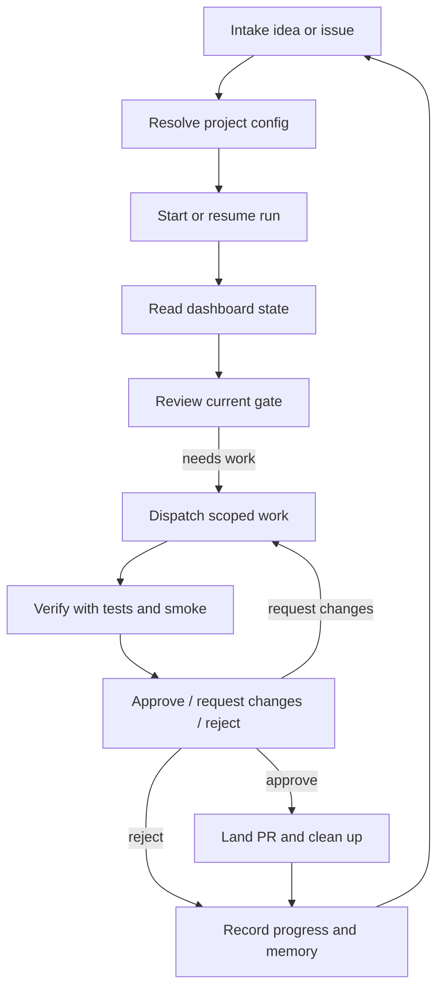
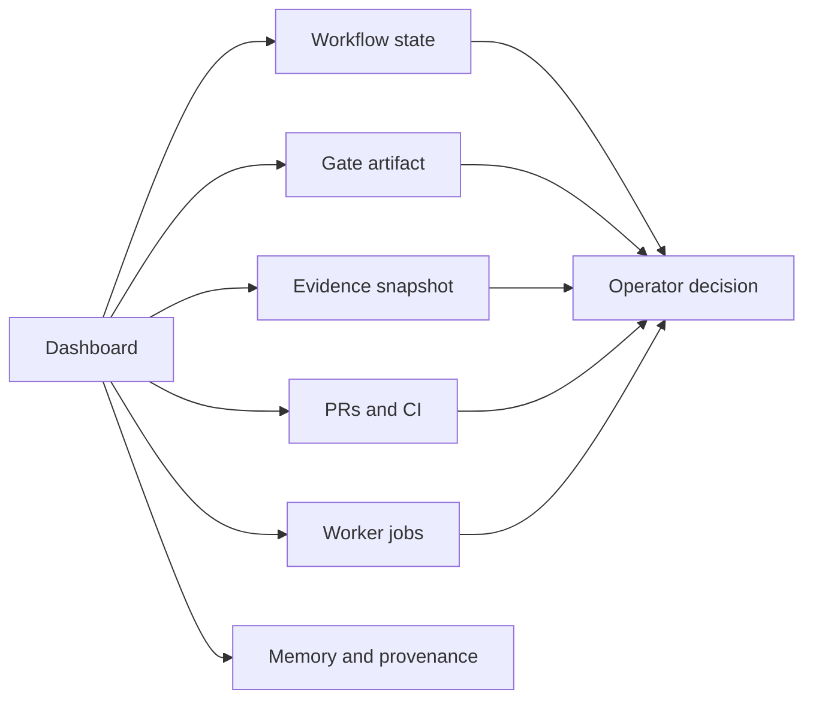
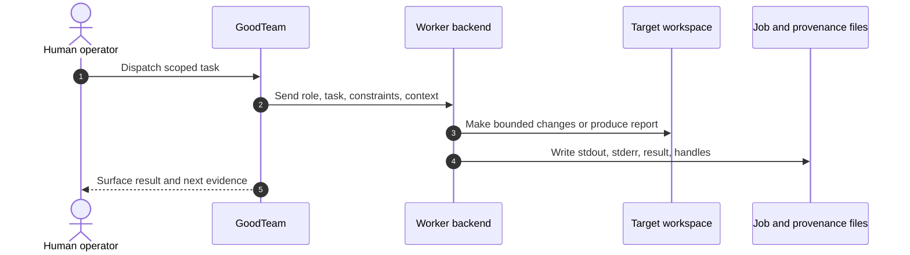
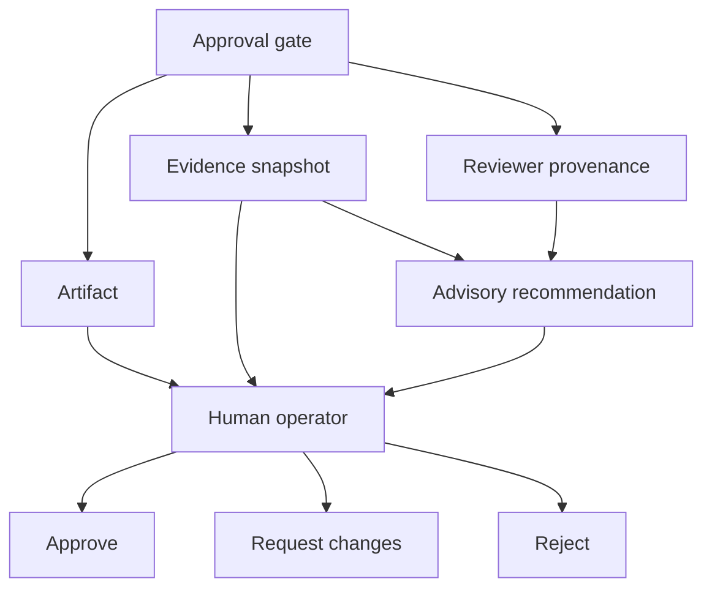

# GoodTeam Operator Guide

This guide describes the day-to-day GoodTeam operating loop for a human operator.
It is about using GoodTeam safely and consistently, not about changing the
runtime implementation.

For the architecture model, read [`architecture.md`](architecture.md). For PR
verification tiers, read [`testing-strategy.md`](testing-strategy.md). For merge
and branch cleanup rules, read
[`development-branch-hygiene.md`](development-branch-hygiene.md).

## Operator Loop



GoodTeam should make the operator faster and better informed. It should not hide
or replace the operator's judgment.

## 1. Prepare The Project

Use a project config when GoodTeam is working against a target repository. A
minimal setup should name the project, key, repo paths, and worker backend mode.

Typical first-run path:

```bash
python3 -m venv .venv
source .venv/bin/activate
pip install -e ".[dev]"
goodteam-os init --key MYAPP --name "My App" --repo /path/to/myapp
```

Then run doctor when backend readiness matters:

```bash
goodteam-os doctor --project-config projects/myapp.local.yaml
```

Operator checks:

- Confirm the target repo path is the intended project.
- Confirm worker backend readiness before dispatching real work.
- Use `fake` for no-credential smoke or deterministic first-gate demos.
- Do not point smoke or destructive commands at a real active workspace unless the
  command is explicitly designed for that workspace.

## 2. Start Or Resume A Run

Start from an idea or issue:

```bash
goodteam-os start "Build the next scoped increment" \
  --project-key MYAPP \
  --project-config projects/myapp.local.yaml \
  --workspace ./run
```

Open the dashboard:

```bash
goodteam-os serve --workspace ./run --port 8788
```

Dashboard URLs:

```text
http://localhost:8788/
http://localhost:8788/projects
http://localhost:8788/projects/MYAPP/work
```

Project-loading URLs:

```text
http://localhost:8788/projects
http://localhost:8788/projects/MYAPP/work
```

Use `/projects` to register a readable absolute project directory and enter its
Work space in one flow. Registration changes only the GoodTeam data workspace; it
does not initialize Git, create documentation, or otherwise write into the
selected project root. Repeating an import is idempotent and returns the same
project. Readiness facts, detected or confirmed project mode, and pending steps
are persisted in the workspace and handled through Task Assistant after a browser
reload or GoodTeam server restart.

The project home API reports a fresh `git_baseline` with `state` (`non_git`,
`unborn`, `valid_head`, or `invalid`), `head_sha`, and `baseline_required`.
Registration and read-only preparation do not require Git. A new empty project
created through `/api/project-config` initializes Git by default and commits only
its newly generated README and ignore file. Existing repositories keep their
history, branch, and identity configuration.

If initialization fails, the response includes an actionable error and retains
`baseline_required: true`; a leftover `.git` directory is not a valid baseline.
To initialize an imported non-Git directory or retry an unborn repository,
explicitly select regular files in the same-origin `POST /api/git-init` body:

```json
{"project_key": "MYAPP", "initial_files": ["README.md", "src/app.py"]}
```

Unselected staged and untracked files stay outside the initial commit. Without
`initial_files`, this endpoint only reports the missing baseline; it does not
stage the directory. A valid HEAD makes retries idempotent. Invalid metadata or
a root inside another Git worktree must be repaired or reselected before retry.
This initialization state does not itself establish a task-bound execution
snapshot or isolate workflow Workers.

Task Assistant distinguishes a successfully loaded project from one that is
ready to start work, asks for preparation input when needed, and surfaces the
persisted result in the conversation. Mode-specific initialization and
repository-understanding execution remain recoverable, and the backend keeps
workflow start gated until readiness is complete. Old `/legacy?project=MYAPP`
and `/projects/MYAPP/home` bookmarks redirect into the product Work space.

Operator checks:

- Confirm the project key shown in the dashboard matches the intended project.
- Confirm the registered absolute root matches the directory you selected.
- Treat `Loaded` and `Ready` as separate states; do not infer that Init or code
  understanding has run merely because Work is available.
- Confirm the current run and gate are the ones you intend to operate on.
- If multiple projects are active, avoid approving a gate from the wrong project
  context.

## 3. Read The Current State

Before dispatching or approving anything, inspect:

- current workflow node,
- current approval gate,
- latest artifact,
- pending worker jobs,
- PR and CI status,
- evidence snapshots,
- reviewer output,
- project warnings.



Do not decide from a single signal. A green CI run is useful, but it is not the
same as human approval.

## 4. Dispatch Scoped Work

Dispatch only when the current gate or project state calls for bounded work.

A good dispatch has:

- one owner role,
- a clear task boundary,
- explicit files or surfaces in scope,
- constraints and non-goals,
- verification commands,
- expected artifact or PR output.

Standalone `dispatch` tracks require a valid Git worktree root and commit.
Before starting a Worker, GoodTeam retains the original HEAD and index plus the
raw tracked and nonignored untracked files. Each track and its verification
command run in a separate copy. The source checkout is not changed. Unsupported
symlinks, submodules, sparse or unmerged indexes stop preparation with an error.

`changed_files` compares each result with that retained working-tree baseline,
including committed, staged, untracked, deleted and renamed files. Missing
evidence is reported as unknown. Overlapping paths are informational; the
independent integration candidate must merge successfully for `all_ok` to pass.
Inspect `integration.candidate_path` and the report before applying the candidate
to a project. A conflict or failed Worker retains its inputs and outputs.

Pass `--task-id` to resume the same standalone dispatch after a process restart.
An identical completed request returns its original report; changed input needs
a new task ID. Recovery reuses the same job directories and saved Worker and
verification outcomes. An interrupted verification or still-running Worker
requires inspection instead of automatic reexecution. Retained baselines,
reports and candidates live under the Operator state directory's
`dispatch-workspaces/` subtree (`GOODTEAM_STATE_DIR` overrides that directory).
They are not automatically deleted.

Real sequential workflows also require a valid Git root and HEAD at task start.
The run retains its HEAD, complete index and raw tracked/nonignored untracked
input in one independent task directory. UI, implementation and QA share that
directory in sequence so each sees the previous result. Job metadata stays in
the original project store. Later source edits are not incorporated into the
task. The state carries `repository_baseline`; recovery only reopens that
binding and never captures a replacement from the source. A missing baseline,
missing task directory or changed root identity blocks real execution. Start a
new task after repairing the source rather than resuming an unbound older run.

Cumulative workflow results describe the whole task, rather than attributing
the same changes to individual Workers. Retained candidates require inspection
before applying them to a project. Workflow documents remain in the workflow
artifact store instead of being mirrored into the live source checkout. The
current SSH staging adapter cannot attest this retained candidate, so workflow
staging stops before deployment rather than approving a separately configured
remote ref. Fake/noop/manual simulations do not claim
this Git execution evidence. Registered Skill-backed tasks and exact-source
reviews retain their existing captured protocols and admission rules.



Operator checks:

- Do not let a worker broaden scope silently.
- Prefer small PRs that match one issue or track.
- Keep implementation workers separate from review judgment.
- When a worker fails, inspect the failure class before retrying.

## 5. Verify Work

Use [`testing-strategy.md`](testing-strategy.md) to choose verification.

Quick rule:

| Work type | Default verification |
| --- | --- |
| docs-only | Tier 0: diff/link/manual review |
| helper/parser | Tier 1: focused tests and lint |
| API/state projection | Tier 2: focused API/web tests |
| approval/ledger/execution/evidence | Tier 3: focused tests + full backend suite |
| browser/adapter/live path | Tier 4: tests + isolated live smoke |

For live behavior, use [`live-smoke-playbook.md`](live-smoke-playbook.md).

### Project-loading preview verification evidence

This change is Tier 4 because it covers browser-visible routing, project-root
resolution, persisted readiness, and an intentionally read-only import path.
The isolated browser workspace is
`/private/tmp/goodteam-project-load-e2e`; it contains synthetic empty,
existing-codebase, ambiguous, and unreadable targets only.

Verification recorded for this slice:

```bash
PYTHONPATH=src .venv/bin/python -m pytest \
  tests/test_project_readiness.py tests/test_project_import.py tests/test_web.py \
  -q -k "project or readiness or product_spa_path"
# 167 passed, 175 deselected

PYTHONPATH=src .venv/bin/python -m pytest tests -q
# 1393 passed

.venv/bin/ruff check src/goodteam_os/ tests/
# All checks passed

npm test --prefix frontend
# 6 Node tests and 111 Vitest tests passed

npm run lint --prefix frontend
npm run build --prefix frontend
npm run test:e2e --prefix frontend -- --update-snapshots
npm run test:e2e --prefix frontend
# 1 isolated browser acceptance passed in both Playwright runs
```

The Playwright acceptance opens `/projects` directly, verifies idempotent import,
reload recovery, unreadable-root recovery, ambiguous-mode confirmation,
Simplified Chinese and English, mobile/light and desktop/dark rendering, and no
unexpected console errors. It also asserts that import did not create `docs` or
`.git` in the existing target, left the empty target empty, and preserved the
ambiguous fixture file. The expected 403 from the deliberate unreadable-root
request is asserted separately from unexpected console failures.

## 6. Review Approval Gates

At a gate, the operator decides whether GoodTeam may advance. Use
[`review-and-approval-guide.md`](review-and-approval-guide.md) for detailed gate
semantics.



Recommendations are advisory. The human decision is authoritative.

## 7. Land And Clean Up

Before merging or landing:

- Confirm the PR is the intended PR.
- Confirm checks are complete and successful or consciously waived.
- Confirm review findings are resolved or intentionally accepted.
- Confirm no unrelated files or historical commits are included.
- Confirm the branch is mergeable.

After merge, follow
[`development-branch-hygiene.md`](development-branch-hygiene.md):

- delete the remote feature branch,
- delete the local feature branch,
- remove temporary worktrees,
- prune stale refs,
- report final state and any intentionally retained artifacts.

## 8. Record Progress

GoodTeam's value compounds when decisions and lessons are recorded.

Record:

- what shipped,
- what was reviewed,
- what evidence mattered,
- what failed and why,
- what should be remembered for similar future work,
- which follow-up issues remain.

Use `docs/current-progress.md` for rolling project memory when the change affects
GoodTeam itself. Use issue/PR comments for specific GitHub-thread evidence.

## Safety Rules

- Do not run mutating smoke commands in an active real project workspace.
- Do not approve a gate from stale or wrong-project context.
- Do not treat advisory recommendations as automatic approval.
- Do not let the implementation worker be the final reviewer of its own work.
- Do not merge old mixed-history branches wholesale.
- Do not delete untracked artifacts unless they are explicitly disposable.

## Operator Checklist

Before every major decision:

```text
Project and run are correct.
Current gate is understood.
Artifact content was inspected.
Evidence is current enough for the decision.
Reviewer provenance and CI/smoke status were considered.
Verification tier matches the risk.
Decision note explains why this action is safe.
Follow-up work is captured.
```
