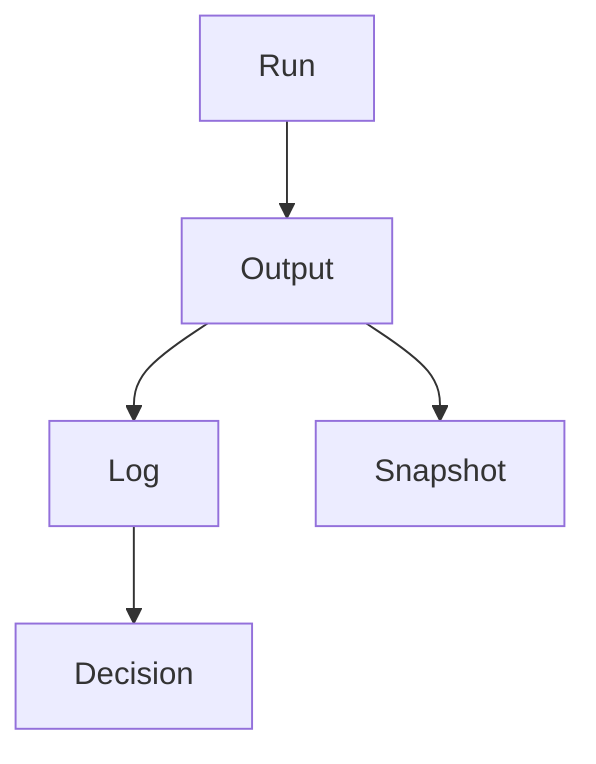

# Provenance Ledger

GoodTeam keeps a record of how outputs were produced.

This is used to trace results back to their origin in a run.

## What It Tracks

## Run
A single workflow execution context.

## Output
Artifacts produced during the run.

## Log
Actions taken during execution.

## Snapshot
State captured at key points.

## Decision
Final human decision on a gate.

## Purpose

- trace how results were produced
- inspect past runs
- support debugging and review

## Notes

The ledger is append-only for auditability.

## Related
- worker-backends.md
- config-reference.md
- memory-model.md
