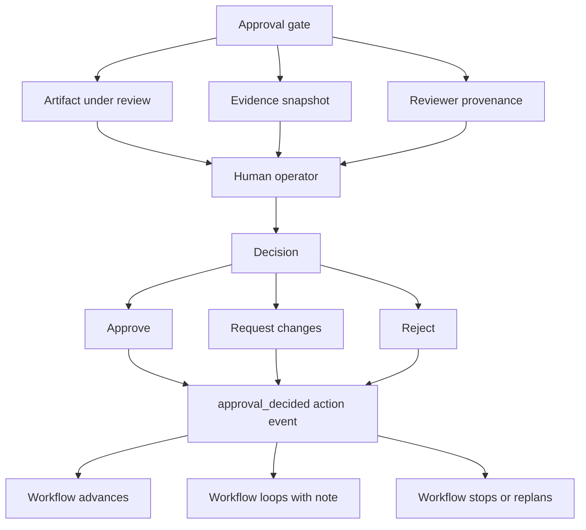
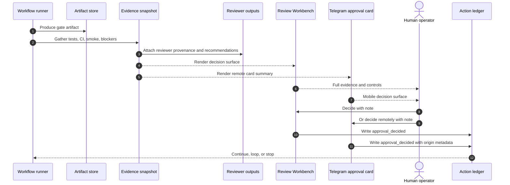
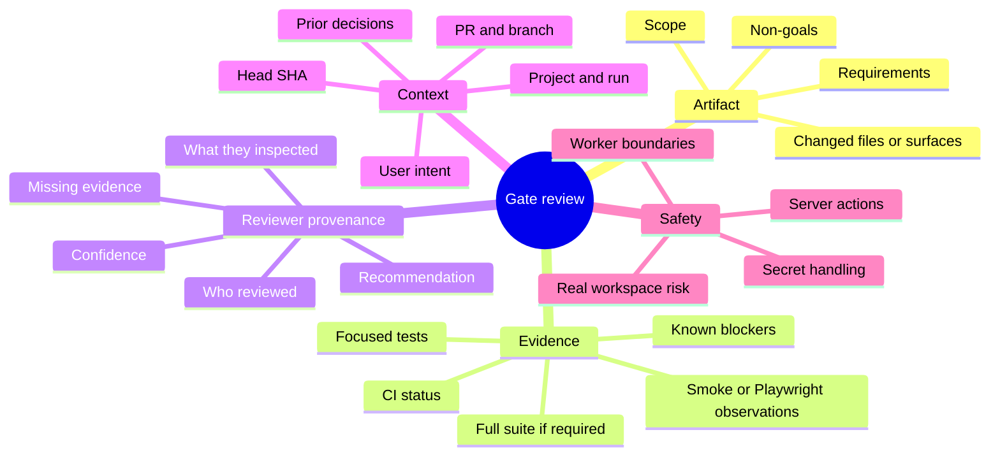

# Review And Approval Guide

GoodTeam uses explicit human approval gates. Automated reviewers, CI, smoke tests,
and provenance snapshots can inform a decision, but they do not replace the
operator.

This guide explains how to read a gate and decide whether to approve, request
changes, or reject.

Related docs:

- [`operator-guide.md`](operator-guide.md) for the full operating loop.
- [`architecture.md`](architecture.md) for the approval/evidence architecture.
- [`testing-strategy.md`](testing-strategy.md) for verification tiers.
- [`live-smoke-playbook.md`](live-smoke-playbook.md) for Tier 4 evidence.

## Gate Model



A gate should answer three questions:

1. What am I approving?
2. What evidence supports or blocks it?
3. What happens after my decision?

Do not approve if any of those answers are unclear.

## Approval Evidence Flow



The same rule applies across Web and Telegram: the human decision is the gate.
Reviewer recommendations are advisory unless a policy explicitly marks evidence as
blocking.

## Decision Types

| Decision | Use when | Result |
| --- | --- | --- |
| Approve | Artifact is correct, evidence is sufficient, and known risks are acceptable. | Workflow may advance. |
| Request changes | Direction is mostly right, but the artifact or implementation needs bounded fixes. | Workflow loops with a note. |
| Reject | The work is wrong, unsafe, obsolete, or based on a bad premise. | Workflow stops or replans. |

## What To Inspect Before Deciding



A gate is not ready for approval just because it looks plausible. It needs enough
current evidence for the risk tier.

## Approve

Approve when all of these are true:

- The artifact or PR matches the intended scope.
- The decision is being made in the correct project and run context.
- The selected verification tier matches the changed surface.
- Required evidence is present and current enough.
- Reviewer findings are resolved or consciously accepted.
- There are no unexplained blockers, stale CI bindings, or wrong-branch signals.
- The operator understands what workflow step happens next.

Good approval note:

```text
Approve: scoped docs-only change. Reviewed docs map and Mermaid diagrams. No
runtime, CI, approval, or worker behavior changed. Tier 0 evidence is sufficient.
```

For control-plane work:

```text
Approve: execution identity change. Focused execution-id tests and full backend
suite passed. PR head SHA matches CI evidence. No worker dispatch behavior changed.
```

## Request Changes

Request changes when the direction is viable but the current artifact is not ready
to advance.

Common reasons:

- Missing verification for the chosen risk tier.
- Evidence is stale, incomplete, or bound to the wrong SHA/branch/run.
- Reviewer recommendation is positive but leaves a material gap.
- Artifact scope is too broad or unclear.
- The PR does the right general thing but includes unrelated changes.
- Live-path work lacks observed smoke evidence.
- The operator needs a smaller bounded retry rather than a full rejection.

Good request-changes note:

```text
Request changes: the UI copy is fine, but this touches dashboard routing and needs
an isolated Playwright smoke with observed route behavior before approval.
```

## Reject

Reject when the premise or execution is wrong enough that a bounded fix is not the
right next step.

Common reasons:

- The work solves the wrong problem.
- The PR is based on stale requirements or wrong project context.
- The implementation violates a safety boundary.
- The worker broadened scope beyond the approved task.
- Evidence shows the approach is broken, not merely incomplete.
- A replacement plan is safer than incremental edits.

Good rejection note:

```text
Reject: this branch changes server-side merge behavior while the approved task was
read-only documentation. Stop this path and re-plan under a separate server-action
issue.
```

## Evidence Quality

```mermaid
flowchart LR
    Evidence[Evidence]
    Evidence --> Strong[Strong]
    Evidence --> Weak[Weak]
    Evidence --> Blocking[Blocking]

    Strong --> CurrentCI[Current CI on matching head SHA]
    Strong --> FocusedTests[Focused tests for changed contract]
    Strong --> FullSuite[Full suite for control-plane changes]
    Strong --> LiveSmoke[Observed isolated live smoke]

    Weak --> OldCI[Old CI or wrong SHA]
    Weak --> GenericPass[Generic "tests passed" note]
    Weak --> UnlinkedScreenshot[Screenshot without path/context]
    Weak --> SelfReview[Implementer self-review as gate]

    Blocking --> FailedCI[Failed required checks]
    Blocking --> MissingArtifact[Missing artifact under review]
    Blocking --> WrongProject[Wrong project/run context]
    Blocking --> UnsafeWorkspace[Mutating smoke against active real workspace]
```

Weak evidence does not always mean reject. It usually means request changes or ask
for more evidence.

## Reviewer Provenance

Reviewer provenance answers:

- Which reviewer or role produced the recommendation?
- What artifact or PR was reviewed?
- What evidence did the reviewer use?
- What was missing or failed?
- Was the recommendation advisory, blocking, or informational?

Reviewer output is useful because it makes the decision surface richer. It is not
sufficient by itself. The operator still owns the judgment.

## Web vs Telegram Decisions

| Surface | Best for | Caution |
| --- | --- | --- |
| Web Review Workbench | Full artifact review, evidence inspection, PR/CI context, detailed notes. | Confirm the selected project/run before deciding. |
| Telegram | Mobile supervision, quick notes, remote approve/request changes/reject. | Do not decide from a summary if full artifact context is needed. |

Telegram decisions should carry origin metadata and enough note context to audit
why the gate moved.

## High-Risk Gate Checklist

Use this checklist for Tier 3 and Tier 4 work:

```text
Project/run context is correct.
Artifact under review matches the issue/PR/task.
PR branch and head SHA match the evidence.
Focused tests cover the changed contract.
Full backend suite was run or explicitly justified.
Frontend build/lint was run when React consumes the payload.
Live smoke was run for browser/adapter/live-path changes.
Reviewer provenance is advisory and understood.
No worker reviewed its own work as final gate.
Decision note explains the risk acceptance.
```

## Anti-Patterns

Avoid these approval patterns:

- Approving only because CI is green.
- Approving from a Telegram summary when the artifact needs full inspection.
- Treating a reviewer recommendation as automatic authority.
- Accepting evidence from a different branch, run, project, or head SHA.
- Requesting vague changes such as "fix it" without a bounded next action.
- Rejecting without recording why the path is unsafe or wrong.
- Letting docs or examples drift into executable contract changes without higher
  verification.

## Good Decision Notes

Decision notes should be short but auditable.

Use this shape:

```text
Decision: approve / request changes / reject.
Scope checked: <artifact, PR, files, or behavior>.
Evidence checked: <tests, CI, smoke, reviewer provenance>.
Reason: <why this is safe or not safe>.
Next action: <advance, fix, re-plan, stop>.
```

The next operator should be able to understand the decision without reading the
entire chat history.
