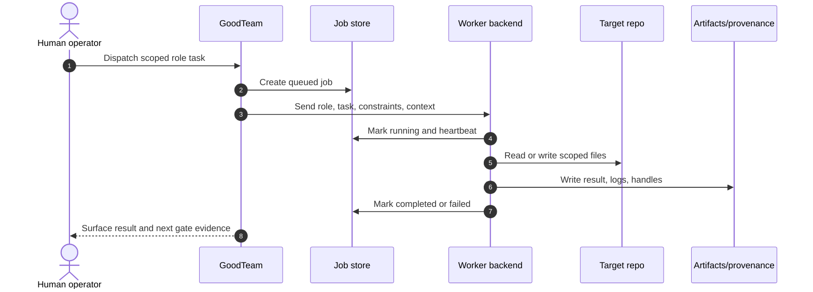
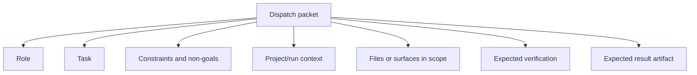
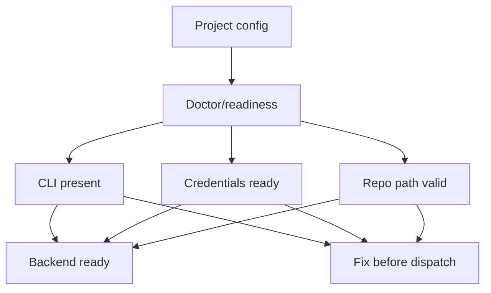
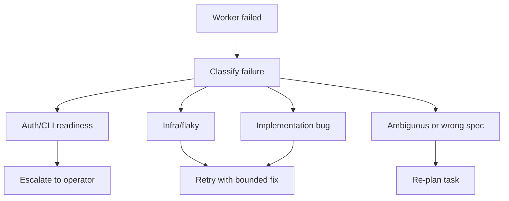

# Worker Backends Reference

GoodTeam dispatches bounded work to worker backends. A backend may be a real
agent CLI, a deterministic fake worker, a human placeholder, or a no-op path.
The workflow ledger remains authoritative; workers produce artifacts and evidence
but do not own approval decisions.

For project-level backend configuration, read
[`config-reference.md`](config-reference.md).

## Backend Lifecycle



## Backend Modes

| Mode | Use for | Notes |
| --- | --- | --- |
| `fake` | First-run demos, deterministic smoke, credential-free local tests. | Good default for onboarding and docs examples. |
| `anthropic` | Claude CLI-backed agent work. | Requires local CLI and credential readiness. |
| `codex` | Codex CLI-backed agent work. | Requires local CLI and credential readiness. |
| `human` | Human-performed or externally coordinated work. | Useful when GoodTeam should track the slot but not run an agent. |
| `noop` | Disabled or intentionally inert work. | Should not be mistaken for completed implementation. |

The committed `projects/example.yaml` uses `fake` by default so a new user can
reach an approval gate without model credentials.

## Dispatch Packet Concept

A useful dispatch packet contains:



Operator rule: if the task cannot be stated as a bounded packet, do not dispatch
it yet. Re-plan or split it.

## Role Backend Selection

Project config has a global default and optional per-role overrides:

```yaml
worker_backend:
  mode: fake
workers:
  ui: fake
  implementation: codex
  qa: fake
```

Anything omitted under `workers` falls back to `worker_backend.mode`.

Use per-role overrides when different roles need different cost, capability, or
risk profiles. For example, implementation may use a coding backend while QA uses
a cheaper or deterministic backend for a narrow check.

## Readiness Checks

Before running real backends, use doctor-style readiness checks.

A backend is not ready if:

- the CLI is not on `PATH`,
- credentials are missing,
- a stale environment variable shadows the intended auth file,
- the selected model profile does not match the backend,
- the target repo path is wrong or unavailable.



Do not discover auth failures by dispatching expensive or mutating work. Preflight
first.

## Result Semantics

A worker result should be treated as evidence, not as approval.

Result files can answer:

- what the worker attempted,
- what files or surfaces it touched,
- what commands it ran,
- what failed,
- what it recommends next.

They do not answer:

- whether the work is safe to merge,
- whether the evidence is sufficient,
- whether the product intent was correct.

Those are human gate decisions.

## Failure Handling



Do not repeatedly retry the same job without changing the cause. A repeated
failure should produce better evidence, not just more logs.

## Safety Boundaries

Worker backends must stay inside their approved scope.

Watch for:

- broad file changes outside the task,
- edits to CI or release scripts when not requested,
- changes to approval, ledger, or server-action code from a docs or UI task,
- deletion of untracked artifacts,
- self-review presented as final approval.

High-risk worker output should go through the review and approval guide before
landing.

## Human Backend

The `human` backend is useful when GoodTeam should reserve a task slot and track
an expected artifact, but the actual work is done outside an agent CLI.

Use it for:

- manual QA notes,
- external account setup,
- design decisions that require founder input,
- actions that should not be automated yet.

A human backend result still needs an artifact or note so the ledger remains
auditable.

## Noop Backend

The `noop` backend should be used deliberately. It means no real work was run.

Do not use `noop` to mark implementation done. Use it to represent disabled,
parked, or intentionally skipped paths.

## Backend Selection Checklist

```text
Task is bounded.
Role is appropriate.
Backend mode is configured.
Doctor/readiness is clean for real backends.
Target repo path is correct.
Expected output artifact is clear.
Verification expectation is clear.
Worker result will be reviewed by an independent gate.
```

## Related Docs

- [`config-reference.md`](config-reference.md)
- [`operator-guide.md`](operator-guide.md)
- [`review-and-approval-guide.md`](review-and-approval-guide.md)
- [`testing-strategy.md`](testing-strategy.md)
