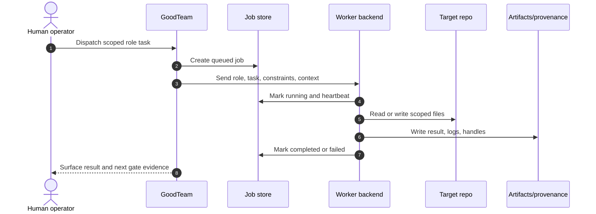
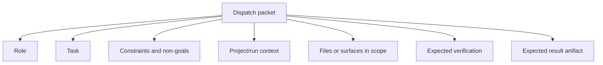
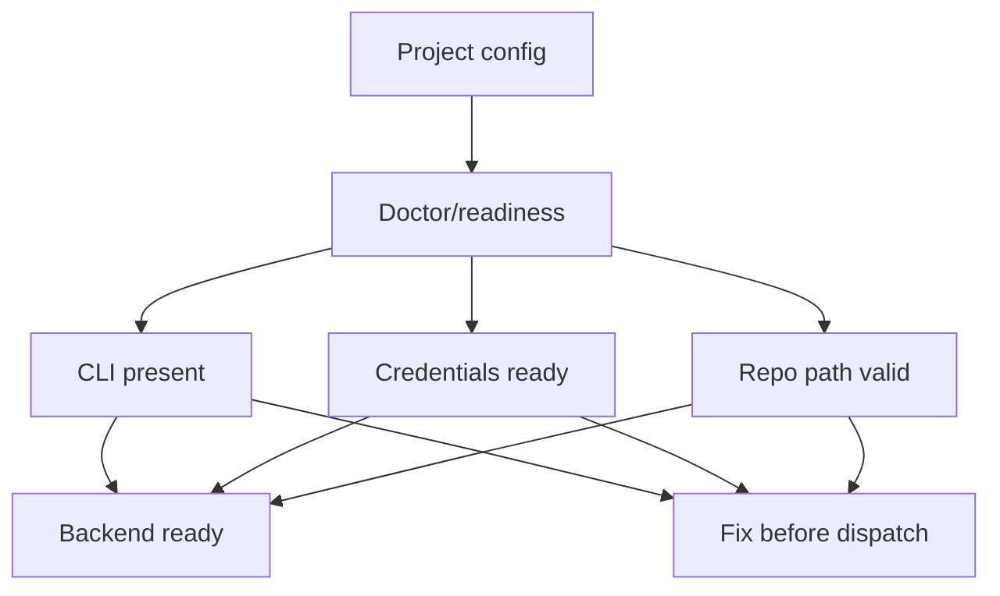
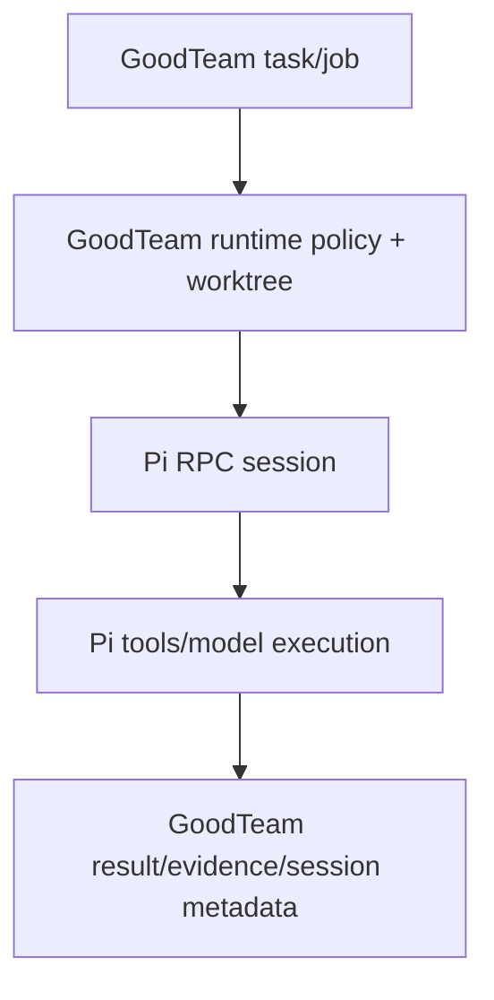
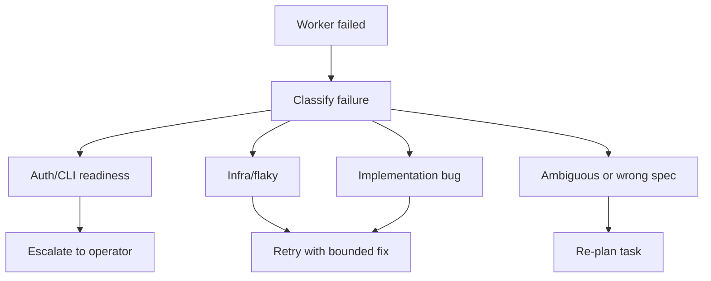

# Worker Backends Reference

GoodTeam dispatches bounded work to worker backends. A backend may be a real
agent CLI, a deterministic fake worker, a human placeholder, or a no-op path.
The workflow ledger remains authoritative; workers produce artifacts and evidence
but do not own approval decisions.

For project-level backend configuration, read
[`config-reference.md`](config-reference.md).

## Backend Lifecycle



## Backend Modes

| Mode | Use for | Notes |
| --- | --- | --- |
| `fake` | First-run demos, deterministic smoke, credential-free local tests. | Good default for onboarding and docs examples. |
| `anthropic` | Claude CLI-backed agent work. | Requires local CLI and credential readiness. |
| `codex` | Codex CLI-backed agent work. | Requires local CLI and credential readiness. |
| `pi` | Pi RPC persistent-session agent work. | Optional; supports resume, steering, follow-up, abort, and incremental event replay. |
| `human` | Human-performed or externally coordinated work. | Useful when GoodTeam should track the slot but not run an agent. |
| `noop` | Disabled or intentionally inert work. | Should not be mistaken for completed implementation. |

The committed `projects/example.yaml` uses `fake` by default so a new user can
reach an approval gate without model credentials.

## Dispatch Packet Concept

A useful dispatch packet contains:



Operator rule: if the task cannot be stated as a bounded packet, do not dispatch
it yet. Re-plan or split it.

## Configure Workers in Team

The Team page starts with responsibility groups. Expand a group only when you
need to inspect or change an individual role or Worker:

| Responsibility | Roles |
| --- | --- |
| Requirements & planning | Research, Product / Requirement, Architect, Review, Planner |
| Design & implementation | UI, Implementation, Frontend, Backend |
| Quality & delivery | QA, Code review, Release |
| Learning & knowledge | Retro / Memory |

The Task Assistant has its own configuration above these groups. Grouping is a
presentation aid; it does not change role identities or dispatch boundaries.
Additional server-defined roles appear under Other responsibilities.

Use **Configure group** to apply an agent, model, and reasoning depth to one
responsibility, or **Bulk configure** to select several groups. Expand a group
inside the configuration dialog to select individual roles. The preview shows
how many Workers will change and how many will be created for empty roles.
Disabled roles are excluded. Names, individual instructions, and paused states
are preserved. The changes are submitted as one team decision.

For individual changes, expand a group and use a Worker's **Configure** button.
New Workers use the project's default agent explicitly. An empty model means
the selected agent's default; **Enter model ID** also works when model discovery
is unavailable. Additional instructions are optional and can be expanded when
needed. Saving a Worker configuration does not invoke the model; the Task
Assistant's separate **Save and check connection** action still performs its
existing connection check.

The default backend is `codex`, and new Codex configurations preselect
`gpt-5.6-sol`. The default `balanced` model profile and the Codex adapter fallback
also use `gpt-5.6-sol`; `GOODTEAM_CODEX_MODEL` can still override the adapter
fallback. Explicitly selected project backends, other named profiles, and saved
Worker configurations retain their settings. When a group's Workers share one
configuration, the dialog prefills that existing configuration.

## Role Backend Selection

Project config has a global default and optional per-role overrides:

```yaml
worker_backend:
  mode: fake
workers:
  ui: fake
  implementation: codex
  qa: fake
```

Anything omitted under `workers` falls back to `worker_backend.mode`.

Use per-role overrides when different roles need different cost, capability, or
risk profiles. For example, implementation may use a coding backend while QA uses
a cheaper or deterministic backend for a narrow check.

## Readiness Checks

Before running real backends, use doctor-style readiness checks.

A backend is not ready if:

- the CLI is not on `PATH`,
- credentials are missing,
- a stale environment variable shadows the intended auth file,
- the selected model profile does not match the backend,
- the target repo path is wrong or unavailable.



Do not discover auth failures by dispatching expensive or mutating work. Preflight
first.

## Pi Persistent Sessions

Pi is the first backend that does not use the one-shot `CLI_BACKENDS` execution
loop. `pi` is the canonical adapter and `pi-rpc` is an accepted compatibility
alias. Install the optional CLI yourself; GoodTeam never installs it:

```bash
npm install -g @earendil-works/pi-coding-agent
```

Configure Pi through local environment settings. Empty provider and thinking
values use Pi defaults; an empty or `auto` model does not force a model:

```bash
export GOODTEAM_PI_PATH=pi
export GOODTEAM_PI_PROVIDER=anthropic
export GOODTEAM_PI_MODEL=auto
export GOODTEAM_PI_THINKING_LEVEL=medium
export GOODTEAM_PI_SESSION_DIR=/absolute/customer-owned/path/pi-sessions
```

Select and verify it like other workers:

```yaml
worker_backend:
  mode: pi
workers:
  implementation: pi
```

```bash
goodteam-os doctor --project-config projects/DEMO.local.yaml
goodteam-os start "Implement the approved task" --project-key DEMO \
  --project-config projects/DEMO.local.yaml --workspace /tmp/goodteam-demo-run
```

The runtime boundary is:



Each job stores `pi_session.json`, `pi_protocol.jsonl`, `pi_events.jsonl`, and
`pi_entries.jsonl` beside the normal `result.md`, `stdout.txt`, `stderr.txt`, and
`status.json`. Session files live under `GOODTEAM_PI_SESSION_DIR`, or by default
under `<project-root>/.goodteam/pi/sessions/`. All of these remain local. GoodTeam
does not publish or upload Pi sessions, transcripts, diffs, or build logs.

New jobs use `session_policy=new`. Infrastructure recovery of the same job reuses
its recorded session without sending the initial prompt twice. A later attempt
may resume only when its caller explicitly supplies a trusted `worker_session_ref`;
GoodTeam validates the project and execution lineage and rejects arbitrary paths.
After a service restart the runtime starts a new `pi --mode rpc` process and uses
Pi's `switch_session` command; PID is never treated as persistent identity.

Control an explicitly bound active job from another shell:

```bash
goodteam-os worker-session status --project-root /path/to/project --job-id job-...
goodteam-os worker-session steer --project-root /path/to/project --job-id job-... --message "Focus on the failing test"
goodteam-os worker-session follow-up --project-root /path/to/project --job-id job-... --message "Also summarize risks"
goodteam-os worker-session abort --project-root /path/to/project --job-id job-... --reason "Operator stopped the run"
```

Pi itself does not provide a filesystem, process, or network permission boundary.
GoodTeam therefore continues to choose the runtime cwd, enforce its existing
worktree/sandbox policy, record claimed paths, and own task/execution, retry,
artifact, PR, CI, review, and approval state. This slice intentionally does not
wire Telegram steering or implement the complete operator loop; the session API
is designed so those adapters can bind to an explicit job later.

## Result Semantics

A worker result should be treated as evidence, not as approval.

Result files can answer:

- what the worker attempted,
- what files or surfaces it touched,
- what commands it ran,
- what failed,
- what it recommends next.

They do not answer:

- whether the work is safe to merge,
- whether the evidence is sufficient,
- whether the product intent was correct.

Those are human gate decisions.

## Failure Handling



Do not repeatedly retry the same job without changing the cause. A repeated
failure should produce better evidence, not just more logs.

For an ordinary CLI job with an explicit invocation budget, start the isolated
service with `GOODTEAM_WORKER_MAX_ATTEMPTS=1`. The cap is captured in each new
CLI job and cannot increase when the service restarts; the current environment
can further reduce it. Valid values are 1–3; invalid values fail before dispatch.
This caps automatic CLI invocations per job, not provider requests or manual
retries/new jobs. Session backends and native admitted protocols retain their
own limits. Do not use this setting as a monetary or provider-request cap.

A host CLI timeout stops for human attention without an automatic retry,
regardless of auth/network text in partial logs. This requires both the host's
deadline summary and no process exit code. A normal nonzero CLI exit reporting a
provider or tool timeout remains eligible for bounded transient retries.

Each finished ordinary CLI attempt retains its result, stdout, stderr and status
under a unique job-local `attempt-*` directory before another retry begins. The
retained status includes its attempt count, failure class when failed, and the
decision to retry, escalate, hand off, or finish successfully. Top-level and
`invocation_evidence` output paths, including transcript aliases of copied files,
refer to the retained bytes. The final job status links to this history and keeps
the existing `recovered` disposition and previous failure class after recovery;
the successful attempt's own status has no inherited failure class.

Worker report excerpts and displayed Worker-result metadata are sanitized before
entering handoff/QA artifacts or their project `docs` mirrors. Recognized
Authorization records are removed as complete values, including scheme tokens,
Digest parameters, quoted/code/table forms and folded continuation lines, before
the excerpt limit is applied. Indented lines immediately following such a record
are treated conservatively as part of it; use a blank line to separate ordinary
report evidence. Metadata values are sanitized separately so later file/artifact
entries remain visible. This is bounded artifact redaction, not a general secret
scanner; it does not rewrite original Worker logs or previously stored artifacts.

Ordinary Codex runs can opt into `GOODTEAM_CODEX_SANDBOX_MODE=workspace-write`
(`read-only` is also supported). This removes the legacy bypass flag and passes
the requested sandbox plus `approval_policy="never"` to Codex. The status records
the requested command policy; this is not proof of OS confinement or acceptance
of the separately admitted native correction route. Unset preserves the legacy
command. Never treat a legacy run as #567 native correction acceptance.

## Safety Boundaries

Worker backends must stay inside their approved scope.

Watch for:

- broad file changes outside the task,
- edits to CI or release scripts when not requested,
- changes to approval, ledger, or server-action code from a docs or UI task,
- deletion of untracked artifacts,
- self-review presented as final approval.

High-risk worker output should go through the review and approval guide before
landing.

## Human Backend

The `human` backend is useful when GoodTeam should reserve a task slot and track
an expected artifact, but the actual work is done outside an agent CLI.

Use it for:

- manual QA notes,
- external account setup,
- design decisions that require founder input,
- actions that should not be automated yet.

A human backend result still needs an artifact or note so the ledger remains
auditable.

## Noop Backend

The `noop` backend should be used deliberately. It means no real work was run.

Do not use `noop` to mark implementation done. Use it to represent disabled,
parked, or intentionally skipped paths.

## Backend Selection Checklist

```text
Task is bounded.
Role is appropriate.
Backend mode is configured.
Doctor/readiness is clean for real backends.
Target repo path is correct.
Expected output artifact is clear.
Verification expectation is clear.
Worker result will be reviewed by an independent gate.
```

## Related Docs

- [`config-reference.md`](config-reference.md)
- [`operator-guide.md`](operator-guide.md)
- [`review-and-approval-guide.md`](review-and-approval-guide.md)
- [`testing-strategy.md`](testing-strategy.md)
