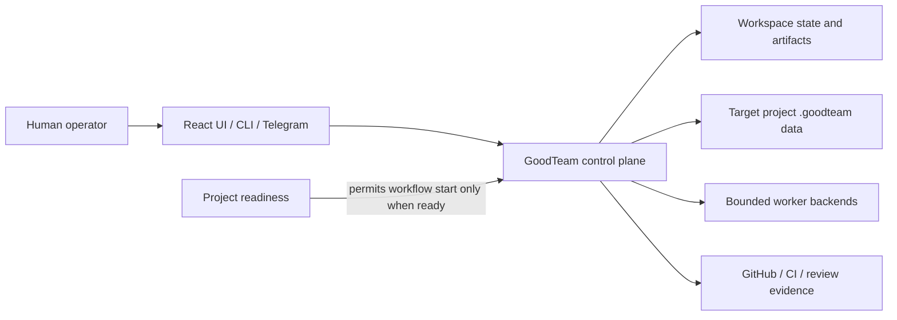

# GoodTeam OpenWiki quickstart

GoodTeam is a **local-first control layer for AI software delivery**. It owns the delivery protocol—workflow state, artifacts, approval decisions, memory, and provenance—while GitHub, CI, Telegram, browser automation, and coding-agent CLIs are bounded adapters that perform work or provide evidence. The authoritative model and lifecycle are detailed in [the control plane](architecture/control-plane.md).

This wiki is an evidence-backed map of the repository as inspected at the initial documentation run. It focuses on the operating model and main extension boundaries rather than cataloging every source file.

## Start here

1. Create an isolated Python environment and install the development package:

   ```sh
   python3 -m venv .venv
   source .venv/bin/activate
   pip install -e ".[dev]"
   pytest -q
   ```

2. For a project configuration, run `goodteam-os init --key MYAPP --name "My App" --repo /path/to/repo`, then use `goodteam-os doctor --project-config projects/myapp.local.yaml` before dispatching a real backend. The committed schema reference is [`projects/example.yaml`](../projects/example.yaml); local `.local.yaml` files are intended to contain machine-specific paths.

3. For the new project-loading experience, serve a workspace and open `/projects`. Importing a directory registers it in the GoodTeam workspace without writing into the selected target. The import/readiness lifecycle and its workflow capability gate are explained in [project readiness](workflows/project-readiness.md).

4. Build the frontend before using managed service commands:

   ```sh
   npm --prefix frontend install
   npm --prefix frontend run build
   goodteam restart
   goodteam status
   ```

   `goodteam` and `goodteam-os` both invoke `goodteam_os.cli:main`; the former adds managed service commands. See [operations and quality](operations/operator-and-quality.md) for service safeguards and verification tiers.

## Documentation map

- [**Control plane**](architecture/control-plane.md) — authoritative state, delivery graph and gates, artifacts/memory, worker jobs, execution identity, and evidence/approval ownership.
- [**Project readiness**](workflows/project-readiness.md) — descriptor-bound project import, mode-specific preparation executors, recovery, readiness persistence, and the server-side workflow unlock.
- [**Web experience**](product/web-experience.md) — Python API plus React product UI, legacy versus product routes, frontend development/build boundaries, and presentation rules.
- [**Operations and quality**](operations/operator-and-quality.md) — service supervision, GitHub/Telegram operator loop, merge safeguards, smoke paths, and test tiers.

## System at a glance



The [web experience](product/web-experience.md) surfaces state but does not decide readiness or approval locally: backend capabilities and ledger transitions are authoritative. The [operator loop](operations/operator-and-quality.md) uses the control plane’s evidence to help a human decide; it does not replace human approval.

## Change-oriented guide

| If changing… | Begin with | Watch for | Relevant checks |
| --- | --- | --- | --- |
| Delivery sequence, gates, approvals, artifacts, or workers | [Control plane](architecture/control-plane.md) | Preserve durable state/checkpoint semantics and gate/evidence ownership. | Focused `tests/test_workflow_table.py`, graph/state/worker tests; full backend suite for ledger/execution changes. |
| Project import, readiness steps, workflow start eligibility | [Project readiness](workflows/project-readiness.md) | Preserve root identity checks, read-only existing-project inspection, idempotency, and stale-run protections. | Project import/readiness backend tests plus API and browser coverage. |
| React routes, project pages, API contracts, or build serving | [Web experience](product/web-experience.md) | Keep frontend as a client of `/api/*`; backend state/capability calculations remain source of truth. | `npm test --prefix frontend`, lint/build, and Playwright for browser-visible paths. |
| Service lifecycle, GitHub/Telegram automation, merge policy, or smoke | [Operations and quality](operations/operator-and-quality.md) | Do not weaken worktree, required-CI, SHA-binding, idempotency, or real-worker opt-in safeguards. | Operator/service tests; relevant Tier 3/4 verification and isolated smoke. |

## Source boundaries and documentation caveats

- Main Python package: [`src/goodteam_os/`](../src/goodteam_os/); frontend: [`frontend/`](../frontend/); backend tests: [`tests/`](../tests/).
- This repository currently has uncommitted changes to `AGENTS.md` and `CLAUDE.md` plus an untracked OpenWiki workflow. They were treated as out of scope and were not modified.
- `docs/operator-guide.md` says that mode-specific readiness execution is not in its project-loading slice. That statement is stale relative to `project_readiness_executor.py`, its API/UI integration, and `docs/readiness-executors.md`; this wiki follows the implemented executor behavior.

## Backlog

- **Review workbench and reviewer policy detail** — `src/goodteam_os/execution/review_workbench*.py`, `src/goodteam_os/review_policy.py`; deferred because the first pass captures approval ownership and operational merge gates but not each review presentation/projection surface.
- **Memory retrieval and cross-project learning detail** — `src/goodteam_os/memory.py`, `src/goodteam_os/cross_project_memory.py`; deferred because the initial architecture page records the persistence boundary but not ranking and future projection mechanics.
